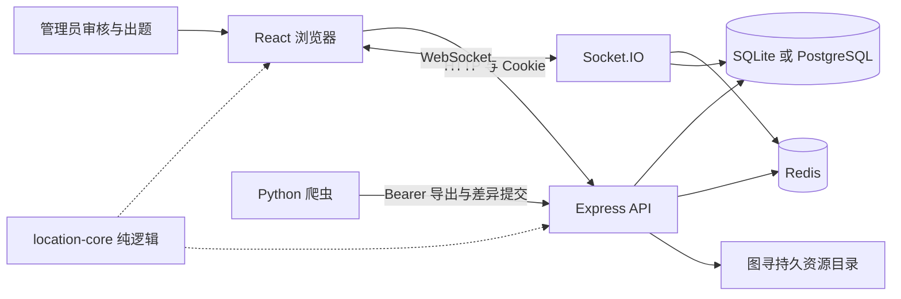
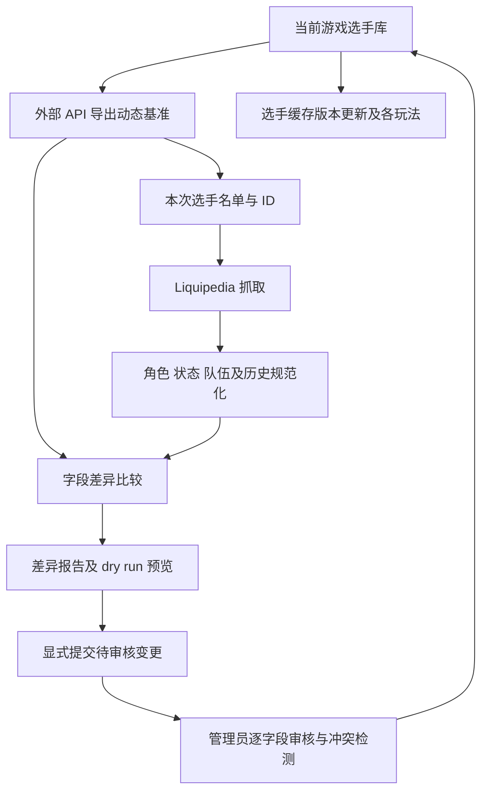

# 弗一把项目设计与智能体接手手册

交接版本：2026-10-23。当前工作区：`F:\friberg-ex`。适用对象是接手代码开发、题库维护、本机验证和未来部署的智能体与维护者。

2026-11-06 仓库拆分：用户要求将爬虫从公开提交移到独立私有仓库。当前分工为 `shnlfriberg/csgofriberg` 维护游戏、后台与外部提交/审核接口，`shnlfriberg/external-scraper`（private）维护爬虫及 `workspace-integration/` 中的专用启动脚本和 Compose 扩展。本机 `external-scraper/`、配置、采集工作数据和原双击入口保留；公开 `.gitignore` 排除私有检出及其联调文件。公共 CI 只安装和测试游戏，缺少私有检出时本机 all 测试跳过可选爬虫；明确指定 scraper 测试但未安装会报错。创建游戏测试管理员不再要求存在爬虫。私有仓库独立运行测试，不依赖父目录的游戏脚本；常规推送只构建镜像，不自动发布 GHCR。此前记载的“公开仓库包含爬虫”均为历史状态。

本轮使用独立检出 `.local-data/split-scraper-20261106/`；两个仓库原历史已保存为本机 Git bundle。公开仓库仅上次混合提交 `7d9895d` 包含爬虫，按用户移除相关提交的要求重做这一提交，保留游戏和 release-data，推送使用明确旧 HEAD 的 lease，避免覆盖并发更新。旧 SHA、GitHub 缓存或他人克隆不等同于当前分支可达历史，改写引用不能保证已公开内容从所有副本消失。真实数据库、采集输出和图片不参与清理。

拆分本机验证：私有仓库独立检出运行 173 项测试，172 通过/1 联网跳过，包含 Windows 启动报告回归；公开测试入口的隔离控制流检查确认 all 仍调用服务端/前端测试并跳过未检出的爬虫，显式 scraper 会报告缺少私有仓库（此控制流检查使用命令桩，不冒充重跑游戏测试）。爬虫源码和联调脚本通过敏感凭据扫描。此前公开提交 `7d9895d` 的完整 GitHub CI 和镜像发布已成功；拆分后 CI 另行记录，不沿用旧结论。

2026-11-04 GitHub 交付：用户明确授权使用本机 GitHub 管理员账号直接更新 `shnlfriberg/csgofriberg/main`，无需 PR。本机登录账号已核实为 `SHISGAY114514`；通过 `.local-data/publish-20261104/repository` 独立检出准备提交，工作区根目录没有初始化 Git。交付内容包括当前源码，以及 `release-data/2026-11-04/` 中可导入图寻 ZIP、内容专用 SQLite/全量图片归档和选手生涯 JSON；详见 [交付包说明](location-bank-transfer.md#2026-11-04-随代码交付的内容快照)。公开仓库不上传账号/凭据/访客身份/个人战绩，原始数据库和备份留在本机。题库 ZIP 已在隔离库实际导入验证；不能把内容专用 SQLite 当运行库覆盖线上数据。主分支 CI 通过后会自动发布 GHCR 镜像，实际线上部署和数据库导入仍是独立操作。

最新完整源码比较与上线复验：**2026-11-04 12:55（Asia/Shanghai）**，详见 [完整比较报告的最新章节](github-comparison-20261023.md#2026-11-04-全量复核与修复验收)。下文旧快照、测试数字及历史结论按各自日期阅读，不替代本次结果。

本轮新修复：选手 JSON 导入强制核对稳定 ID（冲突整批回滚）；卡牌 query 统一返回 400 校验错误；CI 数据库路径满足隔离要求；图片处理新增 1,600 万解码像素总预算、Sharp 单线程和无缓存，并将 Compose 应用/题库导入容器内存从 256 MiB 提高到 512 MiB。192 MiB Node heap 不变；双应用加 PostgreSQL/Redis 的常驻容器上限约 1.5 GiB，目标主机还需操作系统/代理余量。原 256 MiB 场景已实际触发 Docker OOM，最终镜像同场景通过，不能再以旧预算部署。Zod 4 更新同时移除了 partial 更新中的内部默认值，防止只改年龄时覆盖其他字段。

安全依赖更新覆盖 Express、Sharp、Socket.IO、Zod、Axios、React Router、Vite、Vitest 及传递依赖；2026-11-04 pnpm 全依赖审计为 0 告警。爬虫要求 Python ≥ 3.10（推荐 3.12），本机已创建项目独立 `.venv`（CPython 3.12.16），三个 PowerShell 启动/测试入口通过 `scripts/scraper-python.ps1` 优先选它；系统 Python 未替换。requests/urllib3/certifi 升级后的已安装 5 包审计为 0 告警。依赖安全结论仅对应本次审计时间及锁定/已安装版本。

最终验证：服务端 468、前端 331、爬虫 172 项通过，爬虫另 1 项联网测试跳过；完整构建与最终 Linux 镜像通过。受真实 Compose 内存/heap/连接池限制的 PostgreSQL + Redis 双实例验收通过：迁移、认证、密码重置并发消费、图寻快照/故障恢复、卡牌唯一结算/每日最佳/跨零点/回退、100 房间 200 人 2,000 次 HTTP/Socket 操作并行后台构图、两张 4,000×4,000 雷达图的限流与重试。内网操作 P95 8.78 ms；两应用 memory.peak 207.32/148.61 MiB，oom 与 oom_kill 均为 0。指标不是公网用户时延或目标主机容量承诺。

12:55 保真核对：本轮前后 **56 张业务表、2,484 个资源文件、83 个爬虫工作文件完全一致**；无真实数据修复/发布、无旧分数重算。669 人、668 生涯、8,748 任期；当前图 revision 862、646 人/5,277 边，60,000 端点及 9,000 起手验证通过，重建图与当前版本一致且未发布。七图首发符合计划；图寻 1,233 道 published 题、1,121 个可抽独立点，三难度及 87 组禁图组合可用。原模糊任期和待审核内容保持待审核。本机官方脚本已重启最终候选，网页/API/Redis 健康；临时 Docker 验收资源清理并恢复 Docker Desktop 停止。

上线判断：当前代码、数据一致性及受限容器门禁通过，可进入目标环境部署验收；**尚未连接线上主机核实实际镜像/数据库，也未验收真实 SMTP/GeeTest、公网 TLS/代理、目标机备份恢复及真机触控**，不宣称已经上线。指定游戏上游仍为 `99f2e471`，最终固定基线检查 260 相同/59 已审阅差异/0 缺失/0 未预期差异；只更新逐项审阅的 10 个文件哈希。所有本轮证据位于 `.local-data/verification/full-release-audit-20261104/`。

弗一把已从 CS 选手猜测游戏发展为一套包含经典猜选手、每日挑战、多人竞技与协作、海龟汤、图寻、选手数据维护及管理后台的整合项目。当前开发的核心约束是：继续扩展和优化功能，同时保留已经制作的真实题目、图片、地图配置、选手数据和历史战绩。

本文描述当前代码及已有记录能够确认的演进。技术选择背后的解释是对实现及约束的归纳；根目录没有完整 Git 历史，不能据此还原未留下记录的最初开发日期、每次讨论或全部早期提交。旧来源目录中的分支信息不代表当前工作区分支。

## 阅读导航

| 你要做什么 | 优先阅读 |
| --- | --- |
| 刚接手，需要尽快开始工作 | 第 1、2、4、15、20 节及根目录 `AGENTS.md` |
| 理解产品为什么演进成这样 | 第 3 节及各业务章节中的设计解释 |
| 改经典玩法或海龟汤 | 第 5 至 8 节 |
| 改选手数据或爬虫 | 第 9 节，先确认本机版本保留要求 |
| 改图寻或继续制作题库 | 第 10 至 12 节及第 14 节 |
| 改界面、翻译或版本通知 | 第 13、14 节 |
| 排查数据、部署或运行问题 | 第 14 至 19 节 |

## 1 十分钟接手路径

### 1.1 先确认项目边界

游戏公共代码的固定基线是 [shnlfriberg/csgofriberg](https://github.com/shnlfriberg/csgofriberg)，提交 `99f2e471474cfefd38de13033608bdc816a24242`。这是核对过的源码版本，不等于已经连接线上主机验证其正在运行的镜像，也不等于此后 GitHub 永远没有更新。

用户明确指定：`csgofriberg2` 是废弃版本，不再参与代码统一；爬虫和选手数据库更新机制以本机较新的版本为准；图寻及其未上线开发内容不能在公共代码同步中被删除或覆盖。

2026-10-23 交接时，工作区根目录没有 `.git`。`.local-data/upstream/` 中的 Git 检出、`integration/source-archives/` 中的旧文件，以及旧文档写过的分支名，都只能作为来源材料。接手不需要先新建仓库、切换归档分支或推送 GitHub。

### 1.2 确认当前数据

[数据与配置快照](../integration/project-handoff-snapshot.json) 在本次文档编写中只读生成，不含账号密码或 Token。主要数量如下，后续会随正常使用变化：

| 数据 | 本次快照数量 |
| --- | ---: |
| 选手 | 669 |
| 选手难度成员关系 | 1,394 |
| 账号 | 4 |
| 图寻地图 | 10 |
| 图寻正式题目记录 | 408，当前均为 published |
| 采集草稿记录 | 379 |
| 独立位置模型及其版本记录 | 各 381 |
| 地图及题目等历史版本记录 | 841 |
| 图寻每日题单及每日进度 | 各 4 |
| 图寻历史结果及正式交卷标记 | 6 / 3 |
| 当前上传资源 | 822 个 WebP 文件，10,239,752 字节 |

379 个采集草稿、381 个独立位置和 408 道图片题不是同一种计数。一个位置可以有多张图片，位置也可能直接通过正式题目存在，不能因为数量不同而删掉“多余”记录。

### 1.3 找到入口并检查运行状态

```powershell
Set-Location F:\friberg-ex
Get-Content config/local-profile.json
powershell -NoProfile -ExecutionPolicy Bypass -File scripts/start-location-local.ps1 -CheckOnly
Invoke-RestMethod http://127.0.0.1:3002/api/health
```

服务未启动时，优先使用根目录 `启动本机测试.cmd` 或 `pnpm local:start`。网页是 <http://localhost:5175/>，管理后台是 <http://localhost:5175/admin>。登录凭据存于本机 `.local-data/test-admin.json`，只在确实需要登录本机后台时读取，不复制到文档。

### 1.4 修改前形成最小上下文

先定位业务入口、服务端校验、状态存储、前端页面和对应测试，再改代码。涉及数据结构时，额外阅读第 14、16 节；涉及上游统一时，先运行 `pnpm upstream:check` 并读基线说明。不要把全量格式化、清理归档或重置数据当成开始开发的前置步骤。

## 2 产品定位与长期设计边界

### 2.1 产品由两类内容驱动

经典猜选手、海龟汤和经典每日挑战依赖选手资料；图寻依赖人工制作的截图、雷达答案、地图版本与点位。它们共用用户身份、后台、网页框架、限流和部署基础设施，但数据模型与评分机制不同。

因此，“统一整个项目”表示统一工作区、身份和运维边界，并共享合适的基础代码，不表示把图寻强行塞进经典猜选手房间协议，或把爬虫改成直接写游戏数据库。

### 2.2 访客可玩与受控维护并存

大部分游戏支持签名访客身份，登录后可认领永久记录；后台管理需要管理员。随机匹配要求登录并完成邮箱验证，好友房与一般游玩不应因此被整体限制为登录专用。排行榜还受账号可见性、封禁与功能开关约束。

公开访客身份并不是客户端任意填写的字符串。服务端通过签名 Cookie 识别身份，`u:<用户ID>` 与 `g:<访客key>` 是内部身份键；界面展示 ID 另行派生，不能泄露可用于认证的访客 key。

### 2.3 服务器拥有游戏规则

答案、判定、计时截止、扣次数、成绩、排位和是否允许操作由后端决定。前端负责交互、显示、保留待确认请求与恢复状态。不能因为前端按钮已经禁用就省略后端校验，也不能把完整私人服务端对象直接发到公共房间。

### 2.4 内容制作成果必须持续有效

保存成功的题目和草稿属于数据库内容，不依赖浏览器会话，也不要求先导出 ZIP 才能保留。历史回放依赖历史地图、答案和图片，不能通过覆盖同一个图片 URL、重算历史坐标或清空旧版本来“优化”。

当前策略偏向新增结构与兼容读取：旧数据原样保留，新数据使用更合适的存储；有损清理和完全范式迁移不是默认工作。所有后续用户明确指示仍优先于这里记录的默认原则。

## 3 开发演进与主要决策脉络

### 3.1 从猜选手核心发展出公共游戏平台

项目的原始产品核心是类似 Wordle 的逐属性猜选手：提交昵称关联的选手 ID，系统比较国家、赛区、队伍、年龄、位置、Major 成绩和现役状态。后续代码已经具备访客与账号、单人恢复、每日同题、经典多人、接力、2v2、战绩、排行榜、公告和后台。

当前结构把判定、玩法能力、临时状态、持久战绩和管理操作分开维护。这让新增玩法可以复用身份与基础流程，而不需要复制整套应用。单人 `variant` 注册及多人能力注册就是这种结构的体现；它们不是“只加一个配置就能自动拥有任意新玩法”的通用引擎。

### 3.2 选手数据库从静态资料走向审核更新

外部选手资料需要随当前队伍、历史队伍、年龄和角色变化而维护。爬虫因此形成独立 Python CLI，通过实时导出获取数据库基准，抓取与规范化后生成字段差异，再提交待审核项。

这样把网络抓取的不确定性留在独立进程，把正式选手更新留给游戏后台的校验、事务与人工审核。爬取结果不是权威数据库，抓取失败也不能把原有资料清空。

爬虫 `CHANGELOG.md` 的明确版本记录为 2026-09-29 的 v1.0.0，包含队名及历史模板解析、原子状态写入和离线修复流程。当前本机代码还包含 README 与回归测试描述的历史队伍提交兼容逻辑，不能仅按较早 CHANGELOG 的升级文字判断现有行为。

### 3.3 海龟汤沿用选手知识但改用事件记录

海龟汤仍以选手为答案，却把交互改为逐项提问和猜名，共用 24 次机会。它复用单人状态及永久记录入口，但保留目标、可选项与事件快照，避免队名变化后改写已开局的判断或旧回放。

历史代码中的 `maxQuestions`、`remainingQuestions`、`guessUnlocked` 是兼容 API 字段名，当前含义并不是“先问完问题才允许猜名”。直接猜和连续猜都已支持。

### 3.4 图寻形成独立业务域

图寻从“看场景选图落点”发展为随机五轮、每日五轮、好友多人、截图投稿、贡献榜、题库管理与迁移。位置游戏使用截图、地图、楼层和二维距离评分，与猜选手的数据和回合判定差异明显，所以放在独立的 `server/src/location/` 与 `client/src/location/` 中，通过现有应用统一接入。

题目制作从单张上传扩展为先批量标点、再配图、同点多图、逐图编辑与批量发布。这解决的是人工内容制作成本，不能通过自动生成合成图片或复制同一个点位来替代正式题库。

### 3.5 2026 年 10 月 19 日整合本机工作区

整合记录见 [integration.md](integration.md)。游戏与图寻主体来自原 `F:\CS-guesser猜位置小游戏`；爬虫采用原 `F:\external-scraper-main\work\github-external-scraper`；共同游戏代码经比对后没有用爬虫侧旧副本覆盖图寻扩展。

运行数据合并保留账号与选手 ID、难度成员、原审核状态及历史引用。668 人选手库补入图寻库独有的 NiKo，形成 669 人库；没有用图寻开发阶段的 5 人种子覆盖已有维护数据。旧启动配置曾指向带 `csgofriberg2` 名称的数据库，这只解释当时数据来源，不代表现在应同步该废弃代码。

### 3.6 2026 年 10 月 20 日统一公共代码与本机入口

根据维护者要求，公共游戏代码核对到主仓库固定提交。核对结论是公共业务已包含相应修复；差异主要是图寻接入、依赖、页面、部署和本机工具，并非把整站重新实现一遍。

旧本机入口曾指向不同端口、Redis 前缀和数据库。`scripts/local.ps1` 后来成为整合版启动、停止、测试和导入流程的兼容入口，避免维护两套看起来相似、实际连接不同数据的环境。固定哈希检查进一步防止未来同步时静默覆盖本地扩展。

### 3.7 后续交互与内容制作决策

当前已实现并应保留的用户要求包括：

- 娱乐模式用单色勾线小鸭，统一现有图标风格，不能退回彩色系统 emoji。
- 图寻“你的落点”为橙色 `#ff9f43`，与正确答案保持清晰区分。
- 题目管理选择地图和楼层后，可在雷达拖拽矩形筛选范围，支持清除和缩放平移。
- 构建版本、实测 XYZ、视角与地图校准是可选辅助信息，不应重新变成所有题目的强制发布条件。
- 同点位不同图片可以有不同难度与视角，但位置共享，抽题按点位去重。

这些功能的具体最初提交日期没有完整记录，因此不额外指定日期。对于玩家投稿，答案是截图对象或墙面位置；对管理员组织的同站位采集，控制台坐标可作辅助，二者不能不加区分地互相替代。

### 3.8 2026 年 10 月 23 日实施性能与存储优化

用户要求落实审阅提出的优化，并特别要求不破坏已制作题目。先停止本机写入、制作完整备份，再在副本演练迁移，最后应用到实际数据库。

这轮新增查询投影和索引、独立位置模型、修订号缓存、共享回放快照、可读取的进度归档、SQL 结算任务、事务删图任务、图片预算、服务端分页、房间增量广播、共享纯逻辑包和页面懒加载。旧表的原始字段与旧图片保留，迁移核对 27 张旧表及 822 个文件通过。

详细实现、基准和边界见 [location-optimization.md](location-optimization.md)。本机验证通过不等于已经在生产 PostgreSQL、共享卷和完整 Docker 镜像上完成发布验收。

## 4 系统架构与目录职责

### 4.1 运行关系



生产的两个应用实例共享 PostgreSQL、Redis 和图寻资源卷。浏览器不直接连接数据库，爬虫也不直接改库。Redis 除缓存外还保存进行中游戏，因此不是可以随时清空的“可丢弃缓存”。

### 4.2 主要目录

| 位置 | 职责与开发入口 |
| --- | --- |
| `client/src/main.tsx` | 主题、国际化、页面挂载、后台 PoW 与身份初始化、公共通知 |
| `client/src/router.tsx` | 全站路由、管理员入口守卫、重型页面懒加载 |
| `client/src/pages/` | 各玩法与后台顶层页面 |
| `client/src/api/` | Axios、Cookie 身份恢复、PoW、共享 Socket、公开选手列表缓存 |
| `client/src/components/admin/` | 选手、审核、账号、举报、资源版本与图寻后台 |
| `client/src/location/` | 图寻游玩、雷达、回放、贡献榜、统计和前端类型入口 |
| `client/src/i18n/` | 中英日文案、规范值显示翻译、位置及国家显示工具 |
| `server/src/index.ts` | HTTP 中间件顺序、静态资源、Socket、worker、启动和退出 |
| `server/src/routes/` | 经典业务、身份、后台、外部接口等 HTTP 入口 |
| `server/src/controllers/admin/` | 按账号、选手、举报、回放和运维拆分的后台处理 |
| `server/src/services/` | 选手缓存、判定、单人变体、经典多人存储、认证辅助和持久化任务 |
| `server/src/socket/` | 经典多人事件、回合、匹配、观战、恢复与调度 |
| `server/src/location/` | 图寻完整后端域，独立于经典多人状态机 |
| `server/src/db/` | Knex、schema、只读 readiness、迁移、种子与管理员命令 |
| `packages/location-core/` | 无数据库或网络依赖的图寻类型、坐标、校准与点位纯逻辑 |
| `external-scraper/` | 独立 Python 抓取、规范化、比较、提交和部署工具 |
| `pow-wasm/` | Rust PoW 算法；浏览器 Worker 使用已构建 WASM 或 JS 回退 |
| `scripts/` | 本机进程管理、隔离测试、备份验证、资源提取、导入及生产验证 |
| `config/local-profile.json` | 整合版本机地址、路径、Redis 配置 |
| `integration/` | 来源清单、固定上游哈希、合并及验收报告、历史材料 |
| `docs/`、`deploy/` | 业务契约、维护指南、生产部署说明 |
| `.tools/`、`.local-data/` | 本机运行时、凭据、日志、备份及隔离测试数据，不是可发布业务源码 |

### 4.3 后端启动顺序是设计约束

`server/src/index.ts` 先验证生产配置与数据库结构，再连接 Redis、加载选手缓存、启动经典结算 worker，随后装配 HTTP、Socket 和图寻调度器。应用入口只检查 schema；新增表列由迁移命令负责，避免生产双实例同时执行 DDL。

HTTP 装配顺序也不能随意移动：健康检查与运行时公开配置先于 PoW；外部 Bearer API 有独立鉴权与请求体限制；图寻图片及 ZIP 在通用 64 KiB JSON 限制之前解析；普通业务最后进入统一 JSON 解析、路由和错误处理。把大图片路由挪到全局 JSON 之后，会使合法上传被提前拒绝。

### 4.4 退出与恢复

退出时停止接入、调度和 worker，再释放 Socket、Redis、密码线程和数据库连接。经典多人及图寻多人都依赖共享状态恢复，但实现不同。不能用清空 Redis 或删除实例状态的方式“解决重连问题”。本机启动停止器还额外核验 PID、进程创建时间、可执行路径和工作区入口，避免关闭用户其它项目。

## 5 身份 安全与通信约定

### 5.1 统一身份链

浏览器通过 `client/src/api/client.ts` 的同源 Axios 实例请求 `/api`，携带 HttpOnly Cookie。服务端使用登录、刷新和访客 Cookie，结合角色、token version、封禁与缓存判断权限；公开显示 ID 由 `identityDisplay.ts` 派生。

前端启动先渲染页面，再异步恢复身份、计算 PoW 和连接共享 Socket。这样首页不需要等待所有网络和验证工作才显示。需要新增页面时复用这些入口，不在组件内另建一套 Axios、身份 key 或 Socket 连接。

登录认领永久记录的入口在 `server/src/routes/auth.ts`。经典、海龟汤、图寻战绩及投稿贡献各有相应处理；进行中局通常仍按原身份隔离，不能简单把所有 Redis key 从访客重命名为账号。

### 5.2 PoW 与验证码

普通浏览器 API 受 PoW 保护。Worker 优先使用 WASM，JS 作为回退；注册还有专用的一次性证明，GeeTest 和邮件验证承担另外的验证职责，三者不能混同。客户端封装会合并并发验证工作，在明确的 `POW_REQUIRED` 或认证过期情况下有限重试。

修改 PoW 算法要同时考虑 Rust、JS 回退、服务端验证、Worker 协议及预编译产物源哈希。`scripts/build-pow.mjs` 在源码哈希一致时复用预编译 WASM；没有匹配产物时不能假称缺少 Rust 也能安全构建新算法。

2026-10-24 新增邮箱验证码找回密码：登录页“忘记密码”进入 `/password-reset`，必须填写**用户名及该账号已验证绑定的邮箱**，发送时复用现有 GeeTest、普通 PoW 与 SMTP 配置，不另配发信域名。邮件只有 6 位验证码和安全说明，不含网站或重置链接。登录仍使用用户名；重置成功页显示本次填写并验证成功的用户名，提示用该用户名和新密码重新登录。

`POST /api/auth/password/request` 校验格式、人机验证及统一限流后，对用户名/邮箱不匹配、未验证、不存在、邮箱冷却或邮箱额度耗尽均返回相同 `{ok:true,retryAfterSeconds:30}`；SMTP 在返回后异步发送，失败仅记录不含地址的通用告警，不借响应时延或 SMTP 错误暴露账号。格式错误、人机验证失败、IP 超限及共享限流不可用仍返回对应通用错误。邮件发送没有持久重试队列，进程退出或 SMTP 故障后可重新申请。

重置请求 `/api/auth/password/reset` 再次核对用户名、绑定邮箱和验证码，遵循现有 10–128 字符密码策略。验证码 HMAC 摘要与邮箱绑定验证码分表、分用途保存，有效期 10 分钟，错误/验证尝试累计最多 5 次；30 秒发送冷却，每邮箱每小时最多 3 次、发送请求每 IP 每小时 30 次、验证每 IP/邮箱每 10 分钟 10 次。邮箱额度在账号查询前占用，切换用户名不能绕过。密码计算复用有界 worker，放在 SQL 事务外；验证码消费和密码/token_version 更新在同一事务执行，仅一份并发请求可成功，重发或账号状态变化后旧挑战不可用。成功后清理共享认证缓存，并通过原 Socket 身份频道断开既有连接。

2026-10-24 20:28（北京时间）最终验证：隔离服务端 70 文件/416 项、前端 62 文件/309 项通过；本机完整构建与 Docker 镜像构建通过。PostgreSQL/Redis 双实例生产验收通过，新增找回密码验收使用模拟邮件，验证用户名/邮箱查询、并发一次性消费、共享冷却及登录版本更新；SQLite 集成测试另覆盖用户名必填与错配静默、人机验证、PoW、过期、输错上限、重发、SMTP 延迟/失败、访问及刷新凭证撤销。浏览器确认用户名输入框及页面可访问。本机启动流程已执行新增表迁移，API/Redis 恢复健康；没有修改真实账号密码或发送测试邮件。真实 SMTP 收件、外部 GeeTest 和公网 TLS 未实测，没有远端发布。固定上游检查为 261 一致/58 已审阅/0 异常，仅更新已审阅文件哈希。日志：`.local-data/verification/password-reset-username-server.log`、`password-reset-username-client.log`、`password-reset-username-build-local.log`、`password-reset-username-build.log`、`password-reset-username-production.log`、`password-reset-upstream-final.log`。本轮未修改或重测爬虫。

### 5.3 HTTP 与 Socket

普通 HTTP 返回业务错误码，前端做中英日翻译，不能让后端混入固定中文用户文案。Socket 也从现有 Cookie 与连接认证链解析身份；图寻用 `location:*` 事件，经典多人沿用自己的事件和状态。

需要幂等的操作生成一次 `requestId`，保留完整待确认请求。结果不明确时重试同一 ID、版本与内容；冲突或旧版本先同步状态，不能自动生成新 ID 把同一次点击再执行一遍。

### 5.4 访问控制不能只靠隐藏入口

前端 `RequireAdmin` 仅改善页面体验，真正管理权限仍由服务端 `requireAuth`、`requireAdmin` 等中间件判断。随机匹配在服务端检查邮箱验证与相关限制。图寻多人作答前不能向其他玩家发送我的落点；每日交卷前不能泄露当前题目的答案或距离。

服务器还配置 Helmet/CSP、写请求 Origin 校验、IP 与身份限流、请求体大小控制和密码 worker 预算。开发预览换了端口时出现 `INVALID_ORIGIN`，应先检查允许的 origin，不能为测试方便删除生产保护。

### 5.5 外部接口是另一种授权边界

爬虫使用管理员生成的 Bearer Token，不需要浏览器 PoW。数据库只保存 Token 哈希，明文创建时返回一次。当前 Token 不细分端点权限；同一个有效 Token 不仅可能提交审核，也可能调用外部直接写接口，因此不能把它当成只读导出凭证。

本机真实配置、JWT 盐、SMTP 密码、验证码密钥及外部分析 Token 不进入手册。示例配置与运行时公开配置必须保持不含私密凭据。

## 6 经典单人及每日玩法

### 6.1 经典反馈规则

`server/src/services/gameService.ts` 是属性判定入口，最多 8 次猜测。目标 ID 相同即猜中；同国家准确，不同国家但同赛区接近；当前队伍相同准确，猜测队伍存在于目标历史队伍则接近。

年龄接近阈值为 3，Major 冠军数及参赛数阈值为 1，数值不同还返回目标更高或更低的方向提示。角色、赛区及现役状态等按各自规则比较。改变阈值会同时影响复用该判定的海龟汤，不能只检查经典棋盘。

### 6.2 难度依赖成员关系

经典选手难度 key 是 `beginner`、`easy`、`normal`，由 `difficulty_levels`、`player_difficulties`、服务端及前端难度定义共同维护。它们不是图寻的 `easy`、`normal`、`hard`，更不是图片题的 `easy`、`medium`、`hard` tier。

本次选手难度成员数量为 beginner 330、easy 395、normal 669，集合可以重叠，因此总成员数大于选手人数。不能把多难度成员关系误认成重复选手。抽题使用有效选手缓存和近期目标规避逻辑，保证同一身份不会只依赖前端随机选择。

### 6.3 单人变体与状态

`services/singleGame.ts` 组织身份归属、开始恢复及锁；`singleGameStore.ts` 维护活跃状态；`singleGameVariants/` 分派 classic 和 turtle-soup。相同身份、难度和玩法可恢复原局，不同玩法可同时存在。

普通进行中的局主要保存在 Redis，活跃期限约 30 分钟；终局写 `games`，主动退出清理临时状态而不等同认输。结算有按身份的软频率限制，页面显示答案不一定意味着该局计入永久统计，需尊重 `recorded`。

经典记录以选手 ID 与猜测信息为主，当前实现还会刷新部分队伍反馈；海龟汤和图寻则有更明确的答案或地图快照。不要把所有旧玩法都当成相同的不可变回放格式，也不要借统一之名重新计算旧事件。

### 6.4 经典每日挑战

`services/dailyChallenge.ts` 与 `routes/dailyChallenge.ts` 负责上海日期窗口、每日每难度同题和参与记录。当天已分配目标不会因为新请求重新随机；日期与难度唯一约束及锁防止两个实例分配多份。

经典每日状态、排行榜排序和成绩不能直接套用图寻每日规则。现有经典每日服务还包含 90 天题单保留策略；图寻本轮对旧每日题单采取保留策略，二者是不同业务设计。

## 7 经典多人竞技与协作

### 7.1 三种模式

`services/gameModes.ts` 以能力注册集中描述模式约束：

| mode | 当前定位 | 人数与结果 |
| --- | --- | --- |
| `classic` | 独立竞争猜选手 | 2 至 8 人；BO1、3、5、7 相关规则由房间及回合逻辑决定 |
| `relay` | 合作接力 | 2 至 4 人；按配置轮数推进，保存合作解题结果 |
| `relay2v2` | 双队接力竞争 | 固定 4 人、两队，保存队伍与参与者结果 |

新增多人模式需要能力定义、事件校验、状态推进、公开视图、恢复、统计与测试共同支持，不能只新增前端选项。

### 7.2 状态与事件边界

`services/roomStore.ts` 保存房间结构、参与者、观战者、回合、团队、截止时间和回放信息；`socket/handlers/` 按建房、游戏、匹配、重连、离开、观战和再赛拆分处理。

`roundLifecycle.ts`、`matchLifecycle.ts` 推进结果；`roomView.ts` 生成公开内容；`scheduleProcessor.ts`、`workers.ts`、`timers.ts` 处理可恢复期限。需要理解一次操作是否已提交时，要追到原子状态操作或 Lua 脚本，而不是只看事件处理器有没有返回 ACK。

### 7.3 跨实例与持久战绩

Redis 共享房间、匹配、锁、版本及时间调度，Socket.IO Redis Adapter 转发跨实例消息。经典多人结算使用 `services/matchResultQueue.ts` 的 Redis Stream 消费组，再事务写入 `match_records`、`match_players` 和举报等记录；其中包含幂等、待处理恢复与死信处理。

图寻当前采用 SQL outbox 加 Redis 调度，不能把经典 Stream 管道与图寻 outbox 当成同一个队列，也不能只清其中一个就宣称“所有成绩都写完了”。

### 7.4 重连与观战

房间码、用户身份与 socket ID 不是同一个概念。新连接可接替同身份席位；断线宽限、淘汰、团队状态、轮次与版本必须跨进程保持一致。观战者可见内容还应避免对局未结束前泄露目标。

随机匹配需要验证邮箱；受限制匹配池、冷却、准备确认和角色限制在经典多人里有专门实现。图寻随机匹配是双人 120 秒，不具有完全相同的匹配能力，前端不能假设两套 ACK、队列和状态可互换。

## 8 海龟汤模式

### 8.1 玩法思路

海龟汤保留 CS 选手知识主题，让玩家通过属性问题逐步缩小范围，或直接猜选手。提问与猜名共享 24 次机会；属性问题与猜名分别计数，二者相加才是总消耗。第 24 次猜中仍获胜，最后一次属性提问未猜中则终局失败，没有额外赠送猜名次数。

### 8.2 快照与事件

创建对局时复制目标选手，并从有效选手形成队伍及国家选项快照。当前与历史队名都进入选项，因此队名规范化直接影响玩法质量；在一局中途更新选手库，不应改变已经保存的选项或答案。

`services/turtleSoup.ts` 保存 `events`、计数、version、request fingerprints 和状态。事件包含提问值、反馈、方向提示或猜名结果；终局存入 `games.soup_events` 与 `answer_snapshot`。回放按存下来的事件展示，旧事件没有 hint 时不应临时用新选手数据补算。

### 8.3 前端与重试

`client/src/hooks/useTurtleSoup.ts` 与海龟汤页面组织读取、操作和待确认请求。正常操作直接用返回的完整状态替换前端局面，不以定时轮询反复读取。国家搜索在本地匹配语言名称、规范值、中文拼音和首字母，提交值仍是服务端快照值。

次数、是否可猜、身份归属和版本冲突由后端校验。终局回执短期保留以支持丢失响应后的恢复；永久回放按所属身份读取。完整字段和错误码见 [turtle-soup-api.md](turtle-soup-api.md)。

## 9 选手维护 爬虫与审核

2026-11-04 后续首发审计修复：用户已授权修复和测试，排位同玩法待结算屏障、图源 revision+快照校验、爬虫稳定 ID 配对、四场景独立开关、已发布版本受控回退及有界运行监测均已实现。新增 `card_admin_events` 及 catalog/graph 增量列，schema/readiness、维护备份清单和迁移测试同步。独立任期采集加入目录互斥锁与原子文件写入。完整行为与本次复验见 [卡牌修复记录](card-link-implementation.md#2026-11-04-首发审计修复与复验)。

10:27:44 +08:00 写后快照：669 选手、668 生涯、8,748 任期；仅修复 fl4mus/KHRN 两段来源可核实的结束年份，将 hooch/RuSh3D 冲突精确日期标为 unknown 待查，均保留原文与人工保护。不批量批准原 432 条待处理审核。当前图 `bc3d12646c9883b5b051fd040cf163ab5ba9f49f364d466b8c9932564e948d9f`、revision 862、646 人/5,277 边，4 个持久版本。原 3 图 payload、53 对局/49 结果、题单与旧成绩不变；原 56 表中 50 表逻辑内容不变，其余 6 表仅定向资料/审核/图/回执变化，另新增审计表。2,484 个资源与爬虫 83 个工作文件哈希不变，integrity/外键/任期投影通过。备份 `.local-data/backups/card-scraper-fixes-20261104/before.sqlite3`；本机服务已重启，API/Redis 正常。

本次隔离回归服务端 463、前端 331、爬虫 172 通过/1 联网跳过；完整构建、固定上游及新构建镜像的 PostgreSQL 双实例故障/发布/结算门禁通过。新增真实 HTTP+Socket+在线巡检负载：100 双人房/200 人/2,000 混合命令，p95 5.36ms、p99 6.63ms，暖图建局 p95 9.18ms；这些是容器局域网结果。4 图 240,000 组端点、12,000 副起手与全部 49 份历史回放复核通过。后台观测是每实例累计值，需目标环境日志系统接入结构化结算异常事件，不等于已发送外部告警。真实手机、SMTP/GeeTest/公网 TLS/目标主机恢复及远端部署仍须另行验收。证据 `.local-data/verification/card-scraper-fixes-20261104/`。

同轮 30 分钟稳定性已完成：1,800.16 秒、1,682 次开局/结束/结算、12 个图版本轮换，57 次采样；排除前 5 分钟后堆内存 58.55–58.68MiB，无持续增长。汇总与日志哈希见该目录 `final-validation.json`。浏览器随后仅核对大厅/好友设置/排位说明，更新了 1 个既有访客 last_seen_at 和对应 SQLite 序列（未新增访客或对局），单独保真记录见 `preservation-after-browser.json`。临时容器清理完毕，Docker Desktop 恢复停止，本机 API/Redis 保留运行。

历史记录（2026-11-04 09:47—09:57 +08:00）：当时卡牌与爬虫首发审计不满足原计划全模式正式上线要求。副本确认排位待结算仍可重新匹配、players 变更未使关系图候选过期、爬虫按昵称忽略稳定 ID 配对；另缺分场景开关及可操作的旧已发布图回退。当时均待修，未改业务代码或真实审核状态。原始发现、优先级和证据见 [卡牌专题历史审计](card-link-implementation.md#2026-11-04-卡牌连接与爬虫首发审计)，后续状态以上面的修复记录为准。

本轮重新通过隔离服务端 456 项、前端 328 项、爬虫 167 项（另 1 联网跳过）、完整构建/上游检查及 PostgreSQL 双实例门禁。三个冻结图共 18 万组端点、49 份历史结果检查通过；当前 669 人、668 生涯、8,748 任期，3 段精确日期倒置和 432 项生涯待处理审核仍保留，不应写成已修复/已批准。全部 56 张真实表及爬虫状态/输出/缓存 83 文件哈希未变。生产门禁复用同会话已构建本地镜像，未发布远端；真实手机、30 分钟稳定性及外部 SMTP/GeeTest/TLS 未在本轮重测。

2026-11-04 增补：[选手队史时间线基础](player-career-timeline.md)。复用既有 `card_careers` 与 `card_career_tenures`，新增仅补缺失索引的幂等回填和指定日期/带时区时刻的所属队伍、同队选手核心查询。旧 `team_history`、已批准任期 JSON、人工保护和冻结图保留；无日期的队名不迁成伪造任期。查询只读已批准资料，按日粒度、半开区间及原租借/下放规则计算，不代替旧局冻结图。

本次真实库只读副本采集于 2026-11-04 08:58:29 +08:00：669 名选手、668 份生涯、8,748 段任期。副本两次迁移后 56 张表数据哈希不变，quick_check 为 ok；真实库未迁移或写入。验证及副本路径见专题记录。

本次最终隔离服务端验证 74 文件/449 项通过，服务端及共享包构建、固定上游检查通过。首轮新增迁移测试样本遗漏启用字段，补齐后全量复测通过。本机 API/Redis 健康，未重启或发布；无前端/爬虫变更，未新增 PostgreSQL/生产镜像验收。日志 `.local-data/verification/career-timeline-server-final.log`，完整边界与保真证据见上述专题。

### 9.1 更新链路



`baseline_mode=api` 默认每次同步从正式游戏 API 拉取最新状态，避免根据旧文件覆盖管理员刚完成的修正。只有显式选择陈旧基准回退时才允许使用缓存，不能静默回退后继续提交。

### 9.2 Python 代码分工

| 文件 | 职责 |
| --- | --- |
| `cli.py` | crawl、compare、submit、sync、normalize-teams 及参数编排 |
| `pipeline.py` | 同一 sync 流程的 Python 可编程入口，避免复制另一套编排 |
| `scraper/core.py` | 网络、wiki 内容、信息框与历史解析、重试及抓取恢复 |
| `scraper/rules.py` | 状态、角色、员工角色和特殊选手覆盖规则 |
| `scraper/teams.py` | 队伍身份、别名和规范名，不只做字符串相似合并 |
| `scraper/team_repair.py` | 离线队名修复副本与差异生成 |
| `comparator/compare.py` | 新旧字段差异与提交范围 |
| `api_client.py` | Bearer 导出、分批提交、响应与重试 |
| `runtime_utils.py` | Windows/Linux 运行锁与原子文件写入 |

### 9.3 不能丢的业务知识

Spirit 与 Team Spirit 等真实别名需要统一，但学院队、青年队、国家分队、同名不同组织不能因短名相似而合并。历史模板保留链接或 `link=` 的页面身份，是为了区分显示短名与实际组织。

Present、Inactive、Loan、Inactive Loan、教练/分析师/管理/内容创作者及 cmtry 的规则已有专门实现和测试。新增规则优先进入集中规则表；不要为修一名选手在多个处理路径里各加一套昵称条件。旧规则已经丢失的组织身份不能靠简单字符串清理恢复，需要重新抓取与审核。

队名规范化必须覆盖正常抓取、失败回退、断点恢复、离线 compare、skip-crawl 和差异提交路径。比较时数据库旧侧应保留原值，否则会把本来应提交的规范化修复吞掉。

### 9.4 审核与正式变更

`player_change_submissions` 保存批次，`player_change_items` 保存基准值、新值、提交时库内值 observed_value 和审核状态。爬虫传递 expected，提交时基准不符直接标记 conflict；审批前再次核对当前值，覆盖导出到提交、提交到审核两个并发窗口。未传 expected 的旧客户端仍采用提交时值作基准。

`external_submission_requests` 以 token_id＋request_key 唯一，在同一事务中保存内容哈希及回执。相同 Idempotency-Key 和内容重试返回原结果；同键不同内容返回 409。爬虫将 submission_run_id 写入 diff meta，重试复用原 diff、字段白名单和批大小；新 sync 生成新 ID。服务重启不丢去重信息。回执是持久审核数据，不由日常维护清理。

API Token 权限分为 players:read、changes:submit、players:write；新建默认前两项，直接写库需显式授权。已有 Token 的 scopes=null 保留原权限，原哈希、所有者和过期时间不变。

管理员直接编辑、导入和审核通过最终进入 `playerMutations.ts` 等集中更新路径，并使 `playerCache.ts` 的共享版本失效。只写数据库、不刷新缓存，会造成查选手、抽题和不同应用实例内容不一致。

选手 ID 是历史引用。导入按昵称匹配不代表可以重建整表、重新编号或删除已有选手；删除还有停用和历史引用约束。资料中 `team_history` 的省略与空数组也有不同含义，更新接口已经处理保留旧值的情况，不应在前端提交表单时自动补空覆盖。

### 9.5 本机操作边界

真实配置在 `external-scraper/config.json`，示例在 `config.example.json`。默认 dry-run；`爬虫预览.cmd` 或 `scripts/run-local-scraper.ps1 -Mode Preview` 会联网抓取与生成报告，但不提交变更。Submit 模式提交到本机待审核队列，不等同已经批准。

本机启动器读取 `config/local-profile.json` 的 apiPort，校验真实爬虫配置指向同端口的 `127.0.0.1`。2026-10-23 配置为 `http://127.0.0.1:3002`；修改端口后仍需同步真实爬虫配置，脚本不会自动改写 Token 或目标地址。

运行锁防止并发覆盖，竞争时退出码为 75；`sync` 按当前实现进行全量抓取编排，成功后写入的 last_good 是数据库基准快照，不是未经审核的爬取结果。失败不会推进该状态。当前工作区没有因为已有 cron/systemd 示例就自动启用本机定时任务。

完整抓取通常受请求间隔与网络支配。网络失败、基准失败、部分批次提交失败与状态写入失败应保留产物，不得记录成完整成功；需要重跑时从已有差异、日志和 ID 关联定位问题。

2026-10-24 新增根目录 `爬取并提交审核.cmd`，调用 `scripts/run-scraper-review.ps1`。要求后台已启动，复用真实本机配置且检查目标地址、实时基准、禁止 stale 回退和至少 3 秒抓取间隔。此入口显式提交 team/team_history/age/role/is_active/region 六个爬虫更新字段，不改写配置白名单。原 sync 默认不包含任期；新入口增加 `--include-careers`，在同一页面解析时产出 `_scraped_career`（与导出中的已批准 career 分开），保留百科重定向后的规范身份。无需再执行第二遍 career_cli 全库网络抓取。

`career_sync.py` 对照导出的 career_revision 和原始 sourceSnapshot 生成任期计划；使用原外部审核接口、expectedRevision 和确定性幂等键，按每次至少 1.1 秒提交，429/网络故障有界重试。锁定、无采集结果、空历史不覆盖旧数据，报告列出跳过数量。每项回执即时保存，失败保留普通资料已提交回执且不推进 last_good；可用原 diff 和任期计划分别重试。报告保存于 `external-scraper/output/run-reports/`，控制台显示完成或未完整成功，CMD 等按键后关闭；没有启用定时任务或聊天/邮件通知。

历史队名按旧列表与新发现列表增量合并（2026-10-25 修正：保留重复次数和既有顺序，不再去重），删除需明确人工修改。结构化任期由已有 careerSync 合并：匹配既有任期、追加新队伍、仅修改变化且未保护的字段；人工保护日期、无法明确匹配或源缺项保留旧值并进入核对。审批前不会改正式库；卡牌题库图需按既有发布流程更新，旧局快照保持不变。Present 的采集次日截点会随日期变化，不等同变阵。新增回归覆盖“旧队离队结束日期更新＋新队入队＋保留人工起始日期”，以及审批前库不变、审批后保留保护值和重复采集不产生重复修改。

2026-10-24 20:47 北京时间验证：隔离爬虫测试共 153 项，152 项通过、1 项真实联网测试跳过；隔离服务端 70 文件、418 项通过；固定上游检查通过（261 identical、58 reviewed、0 missing、0 unexpected）。新增测试使用临时 HTTP 服务及替代百科内容，验证同一轮采集提交两类审核、预览不提交、部分失败保留回执、人工保护与变阵合并，并在临时工作区实际执行 Windows 启动脚本验证成功和前置检查失败报告。日志为 `.local-data/verification/scraper-review-runner-tests-final.log`、`scraper-review-runner-server.log`、`scraper-review-upstream.log`。本轮未执行真实全库联网采集、未提交真实审核、未改写真实选手库或配置，未部署；未修改前端，因此未重跑前端或生产镜像验收。

2026-10-25 重复历史修复：百科解析、规范化、比较、保存及 API payload 不再按队名去重。别名统一后仍保留每条记录；比较器以序列锚点插入新增次数，次数取旧/新最大值，不删除缺项或因来源重排而增加伪重复。旧 diff 重放同样保留 expected 中的重复历史，旧侧 expected 保持原值用于并发校验。`team_history` 继续排除最后一段 Present 当前队伍，完整任期含当前时段仍由 career 保存，身份及人工日期保护不变。后台既有旧去重提案没有自动撤回或审批，需拒绝后重新生成；本轮没有改写真实库、配置、旧审核记录或已发布关系图。

2026-10-25 本轮验证：隔离爬虫 unittest 共 158 项，157 项通过、1 项联网测试跳过，另有既有规则脚本 997 个断言通过；服务端 70 文件、418 项通过（包含重复队伍送审、审批前不变、审批入库和 JSON 导出保留顺序/次数的 HTTP 回归）；固定上游检查通过（261 identical、58 reviewed、0 missing、0 unexpected）。审阅新增 HTTP 测试差异后仅更新其固定基线哈希及原因。对上轮真实 `diff_20261024_204835.json` 离线重放：19 位变化选手、8 项队伍历史变化，规范化后旧记录出现次数减少为 0；没有发送审核请求。日志及离线报告 `.local-data/verification/history-repeat-*`。本次无前端或服务端生产逻辑变更，未重跑前端、生产镜像或真实联网采集；更新后的 Python 逻辑于下次运行爬虫生效。

2026-10-27 爬虫运行诊断（当时仅离线检查）：20:39:52—21:31:07 本轮 669 人中成功处理 658 人；10 人遭遇 Liquipedia SSL EOF、重试耗尽，另有停用的 seangres #524 未找到页面。旧 core 对存在任何 failed_indices 返回 error，sync 在 compare/submit 前退出，故本轮没有生成审核提交，非后台显示丢失，也不能视为无变化。离线比较发现 allu、blackpoison、bnTeT、r1nkle 共 4 人/5 字段变化。原运行报告 `external-scraper/output/run-reports/20261027-203952-6538d331.json`，诊断 `.local-data/verification/scraper-20261027-diagnosis.json`；后续修复和补交如下。

2026-10-27 部分失败隔离修复：成功选手带 `_crawl_status=success` 继续送审，网络失败、未解析、固定跳过及不在重试范围的选手不产生普通资料或任期差异，也不会借规范化或旧 `_scraped_career` 提交伪变化。全部采集失败仍终止；部分成功标为 `partial_success`、保存失败 ID/昵称/原因，不推进 `last_good`。`sync --retry-failed-from` / `scripts/run-scraper-review.ps1 -RetryFailedFrom` 重新读取实时基准并仅重试清单内选手，不覆盖输入报告，空名单或失效 ID 不会回退成全库爬取。共用 `scraper/exclusions.py` 写死排除 `seangres` / #524，覆盖正常抓取、独立任期工具、缓存及旧计划重放；不影响 `seangares`，不删除正式数据。

任期去噪：比较仍基于 sourceSnapshot；仅忽略两个采集日各自次日生成的 Present 截点向前推进。实际起止日期、身份、队伍、来源等变化仍送审。根据已批准及本次成功来源中的选手/租借入队日期，必要时保留同队现有成员的截止日期延长审核，避免过滤自动截点时丢失新成员连接；不会自动延长人工保护字段或重写已发布图。原 387 条候选中 381 条是纯采集日推进，保留 6 条实质变化。

2026-10-27 23:15—23:16 北京时间真实恢复：使用原快照保留 expected/expectedRevision，补交普通审核批次 #15（4 人/5 字段）和 BELCHONOKK、TjP、allu、belchonokk、bnTeT、tuurtle 共 6 条任期审核；随后只重试 mou、mouz、mynio、mzinho、n0rb3r7、n0thing、n1ssim、nafany、natu、nawwk，10 人全部成功，追加 natu 任期审核 1 条，无普通资料新增变化。共 5 个普通字段及 7 条任期记录等待人工审核，未批准、未发布关系图。核对 players/card_careers/card_career_tenures 与补交前备份完全一致。备份 `.local-data/backups/scraper-review-recovery-20261027/before.sqlite3`；补交计划、原始基准引用与回执 `external-scraper/output/recovery-20261027-203952/`；定向重试报告 `external-scraper/output/run-reports/20261027-231520-da322651.json`。原失败报告与采集文件均保留。

2026-10-27 本次最终验证：隔离爬虫 unittest 共 168 项，167 项通过、1 项既有联网测试跳过，规则脚本 997 个断言通过；覆盖部分 SSL 失败仍送审、全部失败终止、失败别名/缓存隔离、定向重试读取新基准、固定排除不误伤 seangares、Present 日期去噪与新队友截止日期补充、独立任期失败恢复，以及真实 Windows 启动器的部分成功/失败报告。10 人真实定向联网采集另已全部成功。SQLite quick_check 为 ok，5 个普通字段和 7 条任期回执均已核实 pending，正式选手/任期表与备份一致。固定上游检查通过（261 identical、58 reviewed、0 missing、0 unexpected）。日志 `.local-data/verification/scraper-partial-tests-final.log`、`scraper-partial-upstream.log`、`scraper-20261027-targeted-retry.log`，复核证据 `scraper-20261027-recovery-verification.json`。本轮只改爬虫、启动脚本与文档，没有服务端/前端生产逻辑变更，未重跑两端或容器测试，未远端部署。

2026-10-28 00:17:47 北京时间审核排查（只读）：普通资料批次 #15 的 #775—779 全部 approved，批次 #16 的 #780—784 全部 conflict，两批包含完全相同的 5 个字段变更（allu 当前队伍、blackpoison 年龄、bnTeT 当前队伍及历史队伍、r1nkle 年龄）。#16 来自 `20261027-232056-2d4ba4e7.json` 这一轮正常全库运行，于 10-28 00:11:52 提交，当时 #15 尚未审批。一次批准 10 项时按 ID 先应用前 5 项，后 5 项的旧值已不匹配而被标冲突；实际数据库 5 个字段均等于目标新值，没有丢失更新。当前审核只比较 actual 与 old，未将 actual 已等于 new 的重复提案区分为“已生效”；跨运行也不按相同 pending 内容去重。此为已确认的审核提示/去重改进点，本次仅解释，未修改代码或审核状态。

2026-10-28 后台回跳与图片保存速度排查（只读分析，未修改生产代码）：Admin 一级栏目为 `useState('players')`，AdminLocation 二级栏目为 `useState('capture')`，未保存至 URL/会话存储；组件卸载或页面重载必然回默认栏目。正常后台内部切换已保留采集组件，但整页重载无法保留仅在内存中的 File 图片队列、选择和编辑状态；未保存点位另有 localStorage 恢复，已提交数据库数据不因此删除。未发现后台按隐藏时长自动回首页的逻辑；10-27 23:20:42—43 开发日志记录多次 Vite 热更新，浏览器回收、开发服务重连/重载或路由离开均是待现场区分的触发因素，尚未证明用户这一次由哪种因素触发。访问令牌 12 小时、刷新令牌 30 天，刷新成功不会主动清空栏目；身份刷新明确返回 401 才会使管理路由回游戏首页。

同次图片性能证据：10-27 20:39—23:19 进程日志中 `/assets` 92 次平均 35ms/p95 64ms/最大 68ms，关联图片 92 次平均 14ms/p95 38ms，采集转题 92 次平均 42ms/最大 383ms；这是服务端路由统计，不含浏览器处理、PoW 等待及完整端到端耗时，不能据此确认相对以前的速度回退。当前库 745 个采集草稿、812 道题（10-28 只读采集），较 10-23 快照增长；前端逐张串行上传原图并另发绑定请求，每张推进会重算列表，保存下一题还要刷新概览与采集列表。潜在优化为保存阶段计时、小并发且同点串行、列表渲染优化、持久保存栏目/草稿与图片队列恢复。正式 Compose 每应用 256 MiB、V8 堆上限 192 MiB，图片预算按压缩输入计 32 MiB/并发 2，并不能约束 1600 万像素图片的解码与原生内存总量，因此大图并发内存峰值需在目标配置上实测。当前本机 3002 健康接口无法连接且浏览器未打开后台，未现场重现故障、未运行线上压测；本轮不宣称已修复或生产无风险。

2026-10-28 后台反复重载修复（替代上文“未修复”状态）：检查 Vite 6.4.3 客户端发现 `vite:ws:disconnect` 在连接恢复后执行 `location.reload()`，无需发生代码修改；另外开发模块更新也可能产生 full-reload。现场当前页面导航类型是 reload、`document.wasDiscarded=false`；定向关闭 HMR 连接可进入“Polling for restart”路径，但没有把用户此前每一次自然回跳都归因于此。

本机启动改为默认类型检查、构建至 `.local-data/client-preview/` 后启动 preview，去除 HMR 客户端与源代码监听导致的前端刷新；保留 `/api`、`/location-assets` 与 Socket 代理、既有 Cookie/PoW/权限链。显式 `-HotReload` 保留原开发方式，启动说明见 `docs/integration.md`。构建成功后才切换已核验的前端进程；不清空旧哈希资源，以支持旧页面延迟加载。后台一级栏目及图寻二级栏目使用按账号、当前标签页隔离的 sessionStorage 白名单恢复，存储不可用时仍可使用内存导航；恢复图寻/卡牌栏目时也初始化 visited 状态，避免空白。内部切栏继续保持采集工作台及内存图片队列。手动刷新或浏览器销毁页面仍不保证恢复未上传 File 队列，不应声称已实现图片草稿全持久化。

验证：PowerShell 语法检查、稳定前端类型检查和构建通过；隔离前端 62 文件/313 项通过（首次新测试遇异步概览替换节点，改为等待最终可见状态后全量复测通过）；固定上游检查 261 identical、58 reviewed、0 unexpected。浏览器确认稳定页面无 `/@vite/client`、登录及图寻数据正常、两级栏目在手动刷新后恢复；实时代理的 Engine.IO 握手通过，用户原后台实时统计正常。日志 `.local-data/verification/admin-reload-client-final.log`、`admin-reload-start.log`、`admin-reload-upstream.log`。后端业务/爬虫未修改，未重跑对应全套或远端部署。启动沿用既有迁移检查及共享包构建，后端 watcher 会随共享包构建重启工作进程；Redis 保持，未重置数据或重新生成每日题单。

浏览器最终断线验收：在当前后台采集工作台填入临时批次名（不提交），定向关闭已连通的业务 WebSocket；连接随后恢复为 OPEN，实时统计回到正常数值。断线前后 `performance.timeOrigin` 均为 `1793172234979.4`，临时输入及当前图寻栏目仍在，未发生整页刷新。验证后恢复原批次名、关闭独立诊断标签页，保留用户后台。截图 `.local-data/verification/admin-reload-fixed.png`；没有上传或写入测试图片。较早独立诊断页曾遇握手等待，因此最终以当前已连通页面的实际断线恢复结果验收；不把浏览器回收/系统休眠等未测场景描述为已覆盖。

## 10 图寻游玩规则与状态

2026-11-04 首发审计：见 [图寻首发条件审计](location-launch-audit-20261104.md)。09:08 北京时间只读快照为 1,234 题（1,233 published、1 disabled）、七张开放地图、1,121 个可抽点位、1,118 草稿、2,484 个资源文件；七图均超过 20 易/20 中/10 难，Overpass/Vertigo/Train 仍关闭且无题。Train 校准未通过当前偏差检查。数据库完整性、投影/点位/历史引用、图片哈希和新旧 codec 检查通过；当日每日排除后，全部 87 组难度/禁图组合可组题。

同日用户明确七图首发，Overpass/Vertigo/Train 不属于本轮上线范围。后续已修复四项确认问题：必需 Redis 不可用时拒绝状态操作和共享锁；单人/每日已落库结果优先于 Redis 缓存，重试不能改分并保留 UUID 冲突校验；每日榜排除封禁账号；多人视图和新旧回放使用对局内公开席位键，保留账号切换过滤及访客认领兼容。无新增 DDL，旧结果不重算、不批量改写。接口细节见 [图寻接口](location-api.md#2026-11-04-首发修复)。

修复验证：隔离服务端 77 文件/456 项、前端 63 文件/328 项通过；包含图寻 20×8 五轮、杀掉一个进程后 80 席恢复及 160 条唯一战绩。新生产镜像构建及完整 PostgreSQL 双实例门禁通过，新增 SQL 成功/Redis 失败的单人和每日专项，以及两实例 HTTP 最终结果读取。卡牌间歇 preparing 失败定位为验收脚本在延迟唤醒后直接断言旧响应：日志最后一次请求在开局约 1 秒，之后 250 ms 等待延迟超过十秒。现改为唤醒后先读取再判断截止，保留 12 秒期限和 playing 断言；三项独立轮询回归通过，没有修改卡牌玩法或延长超时。生产失败时保留有限服务日志和轮询时间线。

09:42 最终数据保真复核：17 张图寻表、两张选手表以及 2,484 个原有资源全部保持一致，SQLite 完整性及外键检查通过。本机稳定预览已更新，网页 200、API ok、Redis up，未远端发布。轮询修复后的两次完整生产验收均通过，最终提取的轮询辅助模块亦已通过完整流程。证据 `.local-data/verification/location-launch-fixes-20261104/`，审计原始证据仍保留。七图内容和已确认代码缺陷已处理；真实目标环境整站恢复、真机触控/弱网/三语双主题、外部 SMTP/GeeTest/公网 TLS 尚未验证，PostgreSQL 下完整 20×8 图寻玩法故障演练也未执行，不能写成这些发布验收已全部完成。

### 10.1 一局五轮与两种难度概念

图寻一局固定五题，每题最高 5,000 分，合计最高 25,000 分。游玩难度决定五题组成，题目自身的 tier 则描述图片难度：

| 游玩 difficulty | easy 题 | medium 题 | hard 题 |
| --- | ---: | ---: | ---: |
| `easy` | 3 | 1 | 1 |
| `normal` | 2 | 2 | 1 |
| `hard` | 1 | 2 | 2 |

`rules.ts` 按点位去重、优先覆盖不同地图，并用回溯避免贪心抽题耗尽某一档唯一可用点位。三个每日难度合计需要 6 易、5 中、4 难的独立点位；同一点位增加多张图片不等于增加多个独立抽题名额。

新题池仅包括：地图开启、题目 published、题目 mapVersion 与当前地图 version 相符。关闭地图、停用题目或改变几何版本，只影响后续抽题；已经固定的题单及已开局使用自己的快照。

### 10.2 计分公式

`server/src/location/rules.ts` 的 `score` 使用原始雷达坐标和可玩边界计算二维距离：

```text
d = hypot((guess.u - answer.u) * width,
          (guess.v - answer.v) * height)
diagonal = hypot(bounds.width * width, bounds.height * height)
r = d / diagonal

地图错误或未作答：0 分
地图正确：max(1, round(5000 * exp(-5 * max(0, r - 0.005)) * f))
楼层正确 f = 1；楼层错误 f = 0.25
```

没有速度加分，同分并列。地图边界和原始尺寸会影响距离尺度，因此修改这些值属于几何版本变更；不能用网页 CSS 尺寸代替原图尺寸参与计算。

### 10.3 单人模式（内部 random）

2026-10-31：图寻所有原“无限模式”界面文案统一为“单人模式”（入口、标题、规则、战绩筛选/统计及后台在线统计；中英日一致），内部路由/枚举保持兼容。开局难度选择下方新增禁图，可选 0–2 张；五轮题目严格排除被禁地图，游戏内保留红色禁用选项，服务端也拒绝提交这些地图。难度配比、点位去重和当日每日题排除继续生效；题池不足提示减少禁图或调整难度，绝不回退。每日及多人没有禁图界面或规则。

禁图作为可选 `bannedMapIds` 保存于单人状态和回放，恢复及“再玩一局”沿用；旧局默认为空，活跃索引/锁按排序后的名单隔离，空名单继续沿用旧 key。面板默认收起，标题显示已选数量 / 2，收起后保留名单；使用原生 details/summary 支持键盘操作，竖屏可直接看到开始按钮。没有 DDL、真实题库/旧成绩改写或每日题单重生成。详情见 [图寻接口](location-api.md#单人禁图2026-10-31)。

验证（2026-10-31）：隔离服务端 72 文件/438 项、前端 63 文件/327 项通过；完整构建、上游检查通过。前端初次新增测试因按钮无空格的可访问名称断言失败，修正测试后全量通过，折叠调整后 327 项再次通过。Edge 核验选择两图、展开/收起保留计数、每日无禁图面板及 390px 无横向溢出；仅操作开局设置，未开始真实测试局。日志 `.local-data/verification/location-ban-{server,client-final,build,upstream,start-final}.log`，截图 `location-ban-lobby.png`、`location-ban-mobile.png`。本机稳定预览已更新；本轮无爬虫改动、无远端发布。

创建或恢复属于当前身份的对局，逐轮提交后显示该轮结果。新随机与多人题组会排除当日每日题单占用的点位，防止提前练到当天答案；题库不足时返回明确错误，不用重复点位凑够五题。

随机活跃状态主要保存在 Redis，约 30 分钟无有效操作过期；完成第五轮后记录永久结果。主动放弃与结束局的记录语义不同，测试真实环境时不要恢复到用户原有活跃局后又把它当成新测试局放弃。

### 10.4 图寻每日

`games.ts` 的 `ensureDaily` 生成每日三个难度的固定题单；`dailyScheduler.ts` 以 Asia/Shanghai 零点刷新，启动时补齐缺失日期，失败时按计划重试。已有日期直接返回原题单，不因重启、编辑题库或后台“生成”按钮重新抽取。

每日游戏在未交卷阶段不返回答案、正确性、距离或总分。五轮作答后进入 ready，正式提交才进入 finished，并在 `location_daily_attempts` 与 `location_results` 中留存。唯一约束防止同身份、日期和难度重复产生正式成绩。

放弃未正式交卷的局不等于已消耗正式交卷资格；未提交进度在上海零点过期。当天每日榜还受正式交卷资格与账号排行设置限制，不能通过公开历史接口绕过。

### 10.5 图寻多人

好友房为 2 至 8 人，时限可选 60、120、180 秒；随机匹配固定双人、120 秒，要求已登录并绑定验证邮箱，入队与配对时读取当前状态。

```text
waiting → preparing 3 秒 → playing
playing → round_over 8 秒 → 下一轮 preparing
第五轮 playing → finished
所有玩家退赛或房间失效 → cancelled
```

全员提交或服务端时间到才揭晓本轮答案及各人落点。作答前只有本人 `myGuess`、其他人是否已提交和之前轮次的公开成绩。断线保留 30 秒，比赛时间继续走；退赛保留已揭晓分数，之后记 0，且不参与胜者判定。只剩一人时仍可完成五轮；没有中途插入新玩家或观战功能。

房间公开视图在 `roomView.ts`，广播在 `roomBroadcast.ts`。本机连接可协商 `location:room:delta`，接收 `location:room:patch`；只有 baseRevision 匹配才合并，缺口时通过 state 取完整恢复。跨实例远端与旧客户端当前仍接收完整视图，不要声称所有连接都已走纯增量协议。

### 10.6 投稿与贡献

2026-10-29 投稿审核现可直接“并入已有点位”，并提供独立的已有点位显示/隐藏开关。选取当前地图/楼层已有题目点后锁定其答案、展示样例截图，采纳仅新增图片题及贡献，不新建点位或移动原题目；隐藏编号保留选择，地图/楼层切换与目标变化要求重新复核。服务端在保存题目的同一目录锁内检查目标内容指纹和版本，目标被编辑或合并移走时保留投稿并拒绝旧请求。无新 DDL，公共投稿参数仍不能指定正式点位。隔离服务端 434、前端 324 项、完整构建和上游检查通过；本机预览已更新。浏览器在空队列下采用仅当前标签页的临时列表预览，没有实际采纳/拒绝或添加测试投稿；证据 `.local-data/verification/submission-attach-*`。详见 [投稿专题](community-submissions.md)。

2026-10-29 增加题目合并：题目管理选择地图/楼层后，可在独立面板多选 2–100 个相近点，再指定新雷达答案并确认。处理所选点全部已入库题目（含停用/未发布）和已保存采集图片，不受列表分页筛选影响；题目 ID、图片、难度、状态和贡献不变，版本递增，旧 XYZ 移入历史。全部题目/草稿内容指纹防止覆盖并发修改，同请求 UUID 幂等，事务失败整批回滚。合并前记录保存在现有版本表，无新增 DDL；原点位版本序列保留，已固定题单、进行中对局及旧战绩不改。待审核投稿与未保存的本地采集点不参与。操作和限制见 [采集专题第 5 节](location-capture.md#5-题目点位合并2026-10-29)。

本次最终验收：隔离服务端 71 文件/431 项、前端 63 文件/321 项通过，完整构建通过；固定上游检查 261 相同、58 已审阅、0 非预期差异。新增测试覆盖三点合并、所有状态和新旧图片格式保留、旧版本/冻结题库保持不变、同 UUID 并发重试、预览后新增图片或修改草稿冲突、跨楼层/地图过期、截图上限、数据库中途失败整批回滚、管理员鉴权与参数校验。前端首轮新增测试误用 Radar 未实现的 Enter 定位，修正为实际支持的方向键后全套通过。实际浏览器核验多选、目标阶段仅显示选中点、鼠标/键盘标点、取消及 390px 无横向溢出，控制台无错误；截图 `point-merge-desktop.png`、`point-merge-mobile.png`，测试和构建日志 `point-merge-*-final.log` 均在 `.local-data/verification/`。本机稳定预览已更新，API/Redis 正常；真实题库未执行测试合并，未远端部署，本轮未另跑 PostgreSQL 生产镜像验收或爬虫测试。

2026-10-29 更新：玩家投稿支持连续编号标点、每点多图、单图改配及说明、裁剪预览和顺序批量上传，复用原 Radar/裁剪组件与单图审核链。每批未完成图片最多 30 张/256 MiB，每页最多 100 点；接口上限为每身份 60 次请求/小时、每 IP 120 次/小时、100 条待审核。部分失败保留队列，结果不明时固定请求 UUID/点位/说明重试；已确认成功的图片不重发。仅当前页面保存未提交工作，地图/楼层切换不清空；跨页面草稿持久化未实现，不能宣称刷新可恢复图片。新增可选 pointId 输入及 JSON 中服务端生成的点位组，不新增 SQL 表列；身份隔离、游客认领与单图审核修正不会把不同答案强制合并。旧题目、投稿、成绩不回写，具体行为及边界见 [投稿专题](community-submissions.md)。本次隔离服务端 424、前端 318 项与完整构建、固定上游检查通过；日志 `submission-batch-*`，没有远端部署或真实测试投稿。

玩家或访客上传截图并手动标注对象或墙面位置。管理员逐张复核、指定难度后，在同一事务里创建正式题目及版本、写贡献记录、删除待审核项；拒绝走持久删图任务，不因数据库回滚而丢图。

贡献是累计采纳数，不随正式题目后来停用而撤销。贡献榜支持玩家和访客、并列名次及排行隐藏策略。详见 [community-submissions.md](community-submissions.md)，其中早期“拒绝并删除”的即时描述应结合现在的事务任务实现理解。

## 11 图寻采集 地图与题目设计

### 11.1 地图 坐标与楼层

地图定义包含 id、version、enabled、order、原始 width/height、bounds、floors 和 calibration。浏览器雷达采用原始画布归一化坐标 `u/v`，范围 0 至 1，缩放、平移和屏幕分辨率都不改变存储答案。

可选世界坐标转换为：

```text
u = (worldX - posX) / (scale * width)
v = (posY - worldY) / (scale * height)
```

同一地图的楼层共享变换，只更换雷达图；上下层即使 X/Y 相同，也必须使用明确 floorId。原始指令输入只解析数字，不执行控制台命令。

### 11.2 校准思路

坐标辅助采用实测世界坐标与人工雷达标点的成对数据，通过最小二乘拟合统一比例和原点。服务端保存时独立重算，不能把前端拟合结果或管理员手填旧参数直接当成可信几何。

检查要求楼层有足够分散、不共线的标定点，并核对归一化偏差约 0.005。判断不局限于恰好前三点，避免加点或排序后把原本有效标定误判为退化。

校准服务于需要坐标辅助的制作流程，手动雷达答案仍可独立发布。初期“所有题都必须实测坐标并完成全图校准”的计划已经演进，不应直接按旧采集文档开头的早期门槛禁止现有合法题目。

### 11.3 点位与图片题分离

同一地图与 `capturePointId` 标识同一位置，floorId 与世界坐标应一致。一个位置可以对应多张不同朝向、难度和状态的图片题。图片题有自己的 `id`、图片哈希和版本，采集草稿 `id` 则是制作容器的标识。

有实测 world 时，第一张实测题建立共享位置，后续同点图继承位置；容许小范围数值舍入后归一为原坐标，不允许创建同编号不同位置。尚未实测时也共享雷达答案。不要为了让同点图片能同时进入一局而伪造多个点位编号。

新增 `location_points` 与 `location_point_versions` 保存独立位置及位置版本，但兼容题目仍保留完整位置字段。当前保存逻辑还会检查题目、草稿和同点兄弟的约束，这不是已经完成所有旧字段删除和强外键约束的完全范式迁移。

### 11.4 采集工作台

工作流为：建立批次 → 连续雷达标点 → 保存点 → 按点号拍摄 → 批量配图 → 逐图完善 → 审核发布。`点号.png` 与 `点号__后缀.png` 可匹配同点；后缀不决定实际难度。

未保存标点暂存浏览器，已保存点与图片进入数据库和资源目录。切换后台页签保留工作台挂载及未保存输入，隐藏时只暂停重新加载。图片绑定使用客户端 imageId、版本及幂等校验，成功项不重复上传，失败项保留以重试。

当前待上传队列上限是 100 张、合计 256 MiB。它限制浏览器堆积，不是题库总容量；不要通过取消队列限制来解决一次导入大量原图的问题。

### 11.5 题目状态与发布

状态为 draft、review、published、disabled。保存成功后生成新的题目版本；发布需要有效截图、地图、楼层、答案坐标和难度。构建信息、拍摄时间、source、XYZ 和视角是可追溯或辅助信息，不是所有题目的强制发布门槛。

“一键批量发布”针对全题库所有 draft/review，**不受当前搜索、地图、楼层、难度及框选筛选影响**；客户端按最多 500 项分批提交。每项按正常保存路径检查图片、题目版本和地图版本，一项失败不会吞掉其余结果。

地图几何变化后，旧题目需要重新核对并保存到新 mapVersion 才能用于新局。单纯改变开启状态或排序不等于几何更新。历史版本与既有题单继续使用原快照。

### 11.6 范围筛选

当前题目管理使用服务端分页，默认每页 40 条，接口允许最多 100 条。地图、楼层、状态、tier、搜索及矩形边界共同决定结果；同点数量通过分组查询计算，不在每张卡片里遍历全部题目。

矩形参数为 minU、maxU、minV、maxV，必须有完整四项及地图、楼层。边界包含且带微小浮点容差。切图、切层或地图版本变化后旧范围不能继续套用；变更筛选会取消旧请求，过期响应不能覆盖新结果。

### 11.7 题库迁移与人工素材

ZIP 使用 `friberg-location-bank` v1，包含 manifest、内容哈希命名的 WebP 以及所需地图版本；可包含未完成采集点、旧单图格式和多张待出题图。相同题目跳过，同编号不同内容默认阻止，显式允许后以新版本更新，不覆盖旧图片 URL。

导入采用预览 token、30 分钟期限、catalog fingerprint、重新检查和事务提交。最大 ZIP 1 GiB、题目 5,000 道，单素材 16 MiB；服务端还校验路径、条目、哈希、实际图片格式、尺寸与地图引用。导入题库不等于恢复全站账号、每日题单、活跃房间或全部旧战绩。

原始 PNG、拍摄环境与控制台记录由采集侧另外保存；网站保留处理后的中心裁剪 WebP。不要假定通过导出 ZIP 就能恢复上传前的大尺寸原图。

## 12 图寻存储 可靠性与性能

### 12.1 从全量 JSON 扫描到索引读模型

原先很多筛选依赖读完整 payload 再遍历。当前为题目和草稿添加地图、楼层、点位、版本、状态、难度及坐标等投影列；进度增加 game_id、expiry/status/storage version；结果增加 rank/retired。

`projections.ts` 负责新增列、索引、回填与 SQLite/PostgreSQL 触发器。写入仍保存完整 JSON，触发器同步查询列。修改 payload 结构时必须考虑触发器、索引及旧数据，不应只在某一个后台保存函数手工更新索引。

位置的规范模型则由 `pointStore.ts` 在相关事务中写入，不是任意 SQL 修改都会自动维护的投影触发器。批量导入和新管理入口必须使用现有写路径；不能把两类同步机制混为一谈。

### 12.2 缓存与跨实例失效

`location_catalog_revision` 中 id=1 跟踪题库相关变动，id=2 跟踪结果及贡献汇总相关变动。每个进程缓存自身快照，但先读取共享修订号判断是否仍有效，因此其它实例保存后不会无限使用旧题池。

题库缓存采用深冻结，避免调用方改坏后续抽题；要编辑对象必须另做副本。精简概览和全局统计按对应修订号复用。不要将缓存对象当成可变游戏状态，也不要只清一个进程的变量便宣称已完成跨实例失效。

### 12.3 战绩 codec 与不可变快照

新 `location_results.payload` 使用 `storageVersion: 2`，通过 `$locationSnapshot` 引用内容哈希快照，去重地图、房间公共结果和参与者数据；存储在 `location_replay_snapshots`。个人结果与 game 中重复的结果也做了去重。

`replayStorage.ts` 的 encode/decode 在 API 边界还原旧前端所需完整对象，旧 payload 没有新版本标记时仍直接兼容。不能直接对所有新记录执行 `JSON.parse(row.payload).results[i].map` 并假定得到地图。

共享快照是历史证据，不是可以根据当前地图重建的普通缓存。采集迁移时原有 6 条战绩没有重写，所以当前快照表为 0 并不表示优化未启用；新局结算后才会增加新格式数据。

### 12.4 每日进度与归档

活跃每日进度持久化在 `location_progress`，新格式共享地图快照。超过到期时间 7 天、且 storage_version=2 的进度才分批 gzip 后以 Base64 保存到 `location_progress_archive`，并从热表移出；按身份和 game_id 读取仍能恢复。

旧格式进度不自动归档，本次原有 4 条没有被改写。归档不是正式成绩删除，也不是题单重生成；后续如果改变保留政策，必须分别讨论未交卷进度、正式交卷标记、成绩和每日题单。

### 12.5 结算任务与锁

图寻多人完成时先把完整任务持久化到 `location_result_outbox`，Redis 提供兼容载荷及到期调度。worker 可以从 SQL 恢复丢失的 Redis 载荷；缺失指针会移除，避免前一页失效项持续挡住后续任务。

写结果按 game_id＋identity_key 唯一约束幂等。失败延后重试，达到 10 次保留载荷供人工处理，通过管理员 retry API 再入队；锁竞争不计业务重试。不要删除 outbox 行或只看客户端完成页来判断数据库已成功保存。

共享 `services/keyLock.ts` 用 token 校验获取、续租与释放 Redis 锁，原租期约 15 秒、每 5 秒续租；长导入和慢 I/O 不应仅因固定短租期失去互斥。无 Redis 的内存锁只适合相应本机测试或单实例回退，不能替代生产分布式互斥。

### 12.6 文件生命周期

驳回投稿时，SQL 事务删除审核记录并添加 `location_asset_tasks`。事务成功后才执行文件操作；I/O 失败留待重试，事务回滚不删文件。执行时在题库锁内扫描数据库历史与 Redis 活跃引用，有引用则保留。

资源盘点区分 referenced、staged、quarantine-candidate，并给近期上传 7 天宽限。**目前没有启用自动隔离或旧图片垃圾回收，也没有清理历史快照。**候选不等于允许删除，尤其要考虑旧回放、未提交制作流程和完整备份周期。

### 12.7 有界资源与更新预算

图片接收请求最多同时 4 个；解码处理最多同时 2 个，输入合计 32 MiB；单图 16 MiB、最大 1,600 万像素。普通截图先按方向校正，再直接取原图中心 360×360，生成 240×240 缩略图；雷达用途保留允许的原始画布尺寸。

这些限制防止大批上传挤占 HTTP 与 Socket 的 CPU/内存。它们仍需在生产容器内结合 sharp、Node heap 与总 RSS 观测，不能只因本机充足内存就放大默认值。

房间无变化 tick 只更新调度，不增加 revision 或重写完整 JSON；一次广播与结算复用评分结果。前端倒计时拆成子组件，避免每 250 ms 让整个多人页面重新渲染。

### 12.8 可观测接口

以下接口均位于 `/api/admin/location` 前缀下：`/metrics`、`/outbox`、`/outbox/:id/retry` 和 `/assets/inventory`。管理员可查看延迟、字节计数、处理预算、重试与资源状态。具体方法及字段见 [location-optimization.md](location-optimization.md)。

指标在进程内统计，每个耗时指标最多保留最近 256 个样本；它不是持久监控系统，也不是所有实例自动汇总的全站监控。当前没有专门的 outbox 运维图形面板。

## 13 前端组织与界面约定

### 13.1 页面 框架与状态

React 18、React Router、Zustand 与 Axios 构成前端。Zustand 维护账号、访客提示、主题、动效与难度偏好等跨页面状态；具体对局仍以服务器状态为准。`Page`、确认框、Toast、公告和资源更新提示组成公共外壳。

多语言为简体中文、English、日本語，公共、海龟汤和图寻文案有独立入口。新增错误码或交互应补充相应翻译；服务端规范值用于 API，翻译后的队名、国家名称或 UI 标签不能作为数据库新主键。

### 13.2 路由与加载

常见路径包括 `/single/:mode`、`/daily/:mode`、`/multi/room`、`/turtle-soup/:mode`、`/entertainment/location/random|daily|multi|submit`、`/stats`、`/leaderboard` 与 `/admin`。

重型玩法及后台使用 lazy/Suspense；共享 React 依赖保留稳定 vendor 分组。曾经的全静态导入注释已不代表当前策略。随意把依赖 React 的包拆成独立 vendor 可能产生循环引用和 createContext 初始化错误，构建成功后仍需浏览器验证。

图寻统计统一进入 `/stats?variant=location`，旧 `/entertainment/location/history` 作为兼容入口跳转，避免维护两套内容相近的历史页面。

### 13.3 图寻组件边界

| 入口 | 当前职责 |
| --- | --- |
| `location/useLocationGame.ts` | 图寻单人请求、恢复、作答和状态 |
| `location/Radar.tsx` | 雷达及标记呈现、无障碍与图像状态 |
| `location/useRadarGestures.ts` | 平移、缩放、指针与范围选择 |
| `pages/LocationMulti.tsx` | 多人连接状态、动作、恢复与页面编排 |
| `location/RoomCountdown.tsx` | 独立计时刷新 |
| `components/admin/AdminLocation.tsx` | 后台页签、精简概览、编辑弹窗与刷新协调 |
| `components/admin/location/QuestionManager.tsx` | 服务端筛选、分页、框选和批量发布 |
| `components/admin/location/useBatchCapture.ts` | 未保存点、配图队列、绑定及工作台恢复 |
| `components/admin/location/useQuestionEditor.ts` | 题目编辑状态、辅助坐标、上传、保存与版本校验 |

`LocationMulti.tsx`、`useBatchCapture.ts`、`bank.ts` 等仍有较多职责。已经抽出边界不代表所有历史耦合都已消除，进一步拆分应围绕生命周期和协议，不只按文件行数机械切割。

### 13.4 风格与交互记忆

主题有深浅色，首次访问跟随系统偏好；页面需要兼顾小屏、输入法组合输入与键盘操作。图寻雷达标记、正确答案和玩家落点通过既有 CSS 体系显示。

用户指定的单色勾线小鸭由 `DuckIcon.tsx` 实现，玩家落点橙色是有意拉开与答案颜色的差异。不要用彩色 emoji 替换，也不要在公共样式重构中把它重新改回近似答案色。

## 14 数据字典与版本含义

### 14.1 数据库职责

| 表或表组 | 含义及关键边界 |
| --- | --- |
| `users`、`email_verifications` | 账号、验证、权限、封禁及排行设置 |
| `password_resets` | 找回密码短期挑战；每用户最多一行，保存验证码摘要、邮箱、登录版本、尝试次数及到期时间；成功删除、重发覆盖、删账号级联删除。全库备份覆盖此表，选手 JSON 导出不包含认证数据。过期记录不再可用，目前无自动清理任务，最多随账号数增长；不为功能测试清理真实记录 |
| `guest_accounts` | 访客维护和封禁等信息；认证 key 不应公开 |
| `api_tokens` | 管理员外部 API Token 哈希、权限范围与状态 |
| `external_submission_requests` | 外部提交的幂等键、内容哈希与持久回执；维护及备份需保留 |
| `players` | 正式选手资料，ID 与历史引用相关 |
| `difficulty_levels`、`player_difficulties` | 经典选手难度及成员关系 |
| `player_change_submissions`、`player_change_items` | 外部差异批次、字段审核及冲突状态 |
| `games` | 经典单人、海龟汤永久结果及各自回放字段 |
| `daily_challenges`、`daily_challenge_attempts` | 经典每日题目及参与结果 |
| `match_records`、`match_players` | 经典多人对局、轮次信息与参与者记录 |
| `match_reports`、`report_whitelist` | 举报、处理与白名单 |
| `announcements` | 公告 |
| `location_maps`、`location_versions` | 当前图寻地图、历史地图/题目及部分导入回执 |
| `location_questions` | 当前图片题；原始 JSON 加查询投影 |
| `location_capture_drafts` | 采集点和待制作图片，兼容旧单图 asset |
| `location_points`、`location_point_versions` | 独立位置模型与位置变化历史 |
| `location_daily` | 每日期固定题单，不与经典每日混用 |
| `location_progress`、`location_progress_archive` | 每日进度热表和可恢复压缩归档 |
| `location_results`、`location_daily_attempts` | 图寻正式结果和每日资格唯一标记 |
| `location_replay_snapshots` | 新格式回放及进度共享的不可变内容快照 |
| `location_submissions`、`location_contributions` | 玩家待审核截图与累计采纳贡献 |
| `location_asset_tasks` | 提交成功后才允许执行的专属图片删除任务 |
| `location_result_outbox` | 图寻多人结算任务与失败载荷 |
| `location_catalog_revision` | 缓存修订号元数据，不是题目数量 |

图寻新增表清单由 `LOCATION_REQUIRED_COLUMNS` 同时参与 readiness 和本机维护枚举。增加表或关键列时要同步检查与测试，不能只让当前电脑的数据库勉强可运行。

### 14.2 Redis 不是只有缓存

Redis 中有身份相关缓存、PoW、限流、公开选手版本与失效通知、进行中的单人局、经典和图寻房间、匹配与时间调度、经典结果 Stream、图寻 outbox 兼容载荷、锁和资源版本广播。清空实例、错误前缀或使用 FLUSHDB/FLUSHALL 都可能破坏用户正在进行的游戏。

正常本机使用 `friberg-integrated:`，隔离测试使用随机 `integration-tests:<随机值>:` 与第 15 号库。内存回退仅用于明确支持的单实例/单元测试路径；生产要求 Redis 可用且配置持久化。

### 14.3 八类容易混淆的版本

| 名称 | 实际意义 | 随意改变的影响 |
| --- | --- | --- |
| `package.json` version | 包元数据，目前为 1.0.0 | 不会自动迁移数据库或改变 CS2 地图 |
| Git commit / 上游基线 hash | 确定代码来源与审阅差异 | 改基线可能掩盖未经审阅的本机覆盖 |
| `RESOURCE_VERSION` / `VITE_RESOURCE_VERSION` | 构建生成的 13 位毫秒时间戳，资源更新通知标识 | 乱广播会引发错误刷新提示，不能代替实际发布资源 |
| 题目 `build` | 采集时 CS2 构建的可选说明字符串 | 不直接影响当前评分，乱填会损害来源追溯，不能证明地图兼容 |
| 地图 `version` / 题目 `mapVersion` | 几何配置及题目已复核的地图版本 | 不匹配会使题目退出新题池，直接改数字会绕过复核 |
| 题目或草稿 `version` | 编辑并发与历史记录版本 | 旧版本会冲突，手动伪造可能破坏幂等和旧数据保护 |
| 对局 `version` / 房间 `revision` / round | 作答、事件或增量广播顺序 | 混用会造成重复提交、错误合并或丢失状态 |
| `scoringVersion` / `storageVersion` | 评分规则与持久格式版本 | 新规则或 codec 必须兼容历史，不能只改标记 |

因此，“填写游戏构建版本”要先判断是题目采集字段还是后台资源版本广播。前者当前不驱动规则，后者影响在线客户端更新体验；都不是直接修改地图版本或重新计算题目的按钮。

### 14.4 原始 JSON 与投影的维护方法

旧 payload 可能保留新代码尚未使用的字段；非业务迁移应尽量保持字节内容不变。投影用于查询，不应在读取时悄悄覆写原始 JSON。新增内容哈希快照、压缩归档与历史普通 JSON 可以同时存在，维护脚本必须识别格式。

源 SQL、schema、运行库和测试夹具需要共同更新；直接从 SQLite 导出数据到 PostgreSQL 还涉及布尔、时间、返回 ID、JSON 与浮点类型，不是复制文件即可切换。

## 15 本机开发 构建与测试

### 15.1 当前配置与运行时

| 配置 | 当前整合版 |
| --- | --- |
| 网页 | `http://localhost:5175` |
| API | `http://127.0.0.1:3002` |
| Redis | `redis://127.0.0.1:16380`，前缀 `friberg-integrated:` |
| 数据库 | `server/data/csgofriberg.sqlite3` |
| 图片 | `data/location-assets/` |
| Node | `.tools/node-v26.10.0-win-x64/` |
| SQLite 兼容 | `.tools/sqlite-shim.cjs`，本机 NODE_OPTIONS 注入 |
| 进程记录 | `.local-data/location-services.json` |
| 本机身份配置 | `.local-data/location-runtime.json` |
| 账号凭据 | `.local-data/test-admin.json` |

根 `.env` 提供运行配置，但本机启动器还会显式设置整合版路径、端口和身份密钥。共享 profile 覆盖启动、测试和本机重置；爬虫固定地址、个别历史脚本及示例文档仍需单独核对，不能认为所有配置已自动派生。

### 15.2 推荐启动与停止

```powershell
Set-Location F:\friberg-ex
$env:PATH = (Join-Path $PWD '.tools/node-v26.10.0-win-x64') + ';' + $env:PATH
pnpm local:start
# 完成后按需要停止；启动中的用户会话及 Redis 会按既有流程保存
pnpm local:stop
```

需要打开系统浏览器可用双击启动器；脚本的 `-NoBrowser` 只启动服务。不要另外启动默认 3000/5173 的旧实例，再把“账号不存在”或“题库为空”误判为数据损坏。

本机缺少 better-sqlite3 所需的 C++ 环境，使用 Node 26 内置 SQLite 的兼容 shim；它不是生产 PostgreSQL 依赖。安装可选 native SQLite 失败时先检查本机方案，不要因此删库或更改生产 DB_CLIENT。

### 15.3 依赖与共享包

当前包管理器为 pnpm 11.13.1，workspaces 包含 client、server、packages/location-core。共享包输出 ESM、CommonJS 和类型声明；client/server 的 dev、test、build 有前置构建，双击启动器也会构建它。

首次直接运行 location:import/export 等 CLI 前，应先构建共享包或项目，不能假定源码仓库里必然已有 dist。不要修改生成后的 dist 文件代替源文件。

```powershell
pnpm install --frozen-lockfile
pnpm --filter @friberg/location-core build
pnpm --filter client build
pnpm --filter server build
# 标准完整构建还会检查或构建 PoW
pnpm build
```

已有本机依赖的维护中，pnpm deploy 之后若出现依赖状态检查错误，可先核对 lockfile 与安装元数据，再用明确的非生产安装模式恢复开发依赖；不要使用自动清理工作区的办法排障。生产依赖打包检查应优先放在独立工作目录。

### 15.4 测试必须隔离

```powershell
.\scripts\test-integrated.ps1 -Suite server
.\scripts\test-integrated.ps1 -Suite client
.\scripts\test-integrated.ps1 -Suite scraper
# 确实需要全套时
.\scripts\test-integrated.ps1 -Suite all
```

脚本为每次运行生成新的数据库、资源目录和随机 Redis 前缀，默认连接本机 Redis 第 15 号库。服务端集成测试需要 Redis，部分单元测试则刻意验证无 Redis 回退，因此 `REDIS_REQUIRED=false` 不能解释成整套测试不需要 Redis。

也支持 `-RedisUrl 'redis://127.0.0.1:16381/15'`，前提是另有独立测试 Redis 正在该端口运行。测试结束只停止自己创建并核验归属的辅助服务，不终止正式本机服务。

直接 `pnpm test` 只跑前后端，也可能继承实际 `.env`；不要在没有显式隔离 DB_URL、LOCATION_ASSET_DIR、REDIS_PREFIX 和 Redis 库的情况下直接执行数据库集成测试。爬虫不包含在该 pnpm 脚本里。

### 15.5 按改动选择验证

| 修改范围 | 应关注的验证 |
| --- | --- |
| 经典反馈、难度或单人变体 | gameService、singleGameStore、相关 HTTP、前端棋盘与海龟汤复用规则 |
| 经典多人 | roomStore、Socket 集成、匹配、重连、结果队列及团队回放 |
| 图寻房间、锁或结果 | 图寻双进程 Socket 演练、outbox 恢复、幂等及私人落点测试 |
| 图寻 schema、codec、归档 | 旧库迁移保真、回放还原、旧进度、归档与资源引用保护 |
| 后台筛选与编辑 | Query、分页、范围边界、过期请求、批量发布全量语义及未保存输入 |
| 图片处理 | 方向、精确中心裁剪、尺寸、哈希、预算、事务回滚与引用检查 |
| 爬虫规则或提交 | 离线 fixtures、身份归一、动态基准、字段白名单、批次失败及原子写入 |
| 路由与构建分组 | TypeScript、Vite 构建及真实浏览器加载，不能只看编译完成 |
| 仅文档 | 路径和链接、命令实际定义、数字出处、Markdown 结构及上游哈希检查 |

## 16 发布 备份与恢复

### 16.1 开发与生产是不同环境

本机是 Windows/SQLite/本机 Redis；生产设计是 Linux、Node 26 distroless、PostgreSQL 17、Redis 7.4、两应用实例及共享图寻卷。生产必须提供稳定密钥、精确 CORS origin、必要邮件/验证码配置和 Redis 持久化。

Compose 中 migrate 成功后才启动应用；数据库表结构检查失败时先看迁移，不要在 app-1/app-2 中各自自动执行 schema 更新。镜像中的命令用 `server/dist/...js`，没有开发时的 pnpm、tsx、Vite 和 TypeScript。

### 16.2 镜像来源与验收门禁

Compose 默认镜像已与部署说明统一为 `ghcr.io/shnlfriberg/csgofriberg:latest`。实际发布仍应显式固定经过验收的 IMAGE tag/digest，不能推断现有远端镜像已包含本机改动。

`.github/workflows/docker.yml` 已启用面向 main 的 pull_request，以及 main push、版本 tag 和手动触发。先跑前后端及爬虫测试，再加载候选镜像执行隔离 PostgreSQL 验收；成功后非 PR 才使用相同构建输入和缓存发布并附 provenance/SBOM。脚本覆盖旧库和重复迁移、图寻投影/回放、双实例结算、共享图片卷及外部提交并发幂等。此次没有发布镜像或执行线上操作。

2026-10-23 后续已安装 Docker，并在 Linux 生产镜像、隔离 PostgreSQL/Redis 及实际 Compose 编排中通过投影、回放、提交幂等、共享图片和双实例重启持久化验收，见第 17.7 节。真实数据迁移、整站恢复、第三方验证码/邮件和公网 TLS 仍需上线环境单独验证。

### 16.3 发布时的状态与资源

两实例共享数据库、Redis 和图片卷。静态前端资源按内容哈希命名，滚动更新时两个实例可能短暂拥有不同构建，反向代理需要对资源缺失作正确重试，缺失 JS 不能回退成 index.html。

资源版本广播用来提醒旧客户端刷新，不会自动部署新代码、更新数据库或上传图片。Socket 仅使用 WebSocket 时不需要长轮询粘性会话；若以后启用其它传输方式，需重新检查代理策略。

迁移、部署、真实 Token 提交、广播更新或清理生产数据不是阅读本手册自动获得的授权；按当次用户任务执行对应操作。

### 16.4 三种备份不能混用

| 备份 | 包含什么 | 不能替代什么 |
| --- | --- | --- |
| 源码与镜像版本 | 程序、配置示例、构建逻辑 | 不包含本机题目与活跃对局 |
| 题库 ZIP | 当前题目、待完成采集内容、所需地图版本和处理后图片 | 不包含全站账号、个人成绩、固定每日题单、全部历史或活跃房间 |
| 完整恢复集合 | 一致性数据库、整个资源目录、必要 Redis 持久化、对应源码/镜像与受保护配置 | 需要实际恢复演练，不能仅验证压缩包存在 |

运行中的 SQLite 使用 backup API 等一致性方式，不直接复制可能处于写入/WAL 状态的单个文件。PostgreSQL 用一致性数据库备份；图片卷和必要 Redis 状态也要在受控写入窗口保存。

### 16.5 已有重要备份

- `.local-data/backups/location.sqlite3`、`players.sqlite3`：2026-10-19 原库一致快照，见整合记录。
- `.local-data/backups/upstream-unification-20261020/`：公共代码统一前的相关文件。
- `.local-data/backups/before-community-submissions.sqlite3`：投稿功能迁移前数据库，见投稿文档。
- `.local-data/backups/location-optimization-20261023-83ef19ec/`：优化前完整数据库、822 文件、Redis、源码 ZIP 与清单；指针保存在 `.local-data/location-optimization-backup.txt`。

备份不是当前运行数据。用户继续出题后，旧备份只能用于对应时点恢复，不能为了使测试数量恢复到旧值而覆盖新数据。

### 16.6 非业务迁移的保真核验

`scripts/verify-location-preservation.py` 默认比较备份中的旧字段与全部旧行，并校验资源文件哈希、SQLite 完整性及外键。它用于本轮这类不改业务内容的迁移前后核验。

```powershell
python scripts/verify-location-preservation.py --database F:/friberg-ex/server/data/csgofriberg.sqlite3
```

在线读取可能产生新题单或账号活动，工具另支持 `--location-only --allow-additions`。但用户正常编辑已有题目后，当前记录与旧备份不同是合理业务变化；不能把这种差异自动判为损坏，更不能自动恢复旧库。未来迁移应先取得新的基线备份。

### 16.7 回滚与重置

新存储格式上线后，旧源码未必能读取新快照或归档。回滚前确认格式兼容，并把数据库、资源、Redis 和源码/镜像作为对应集合处理；先保留备份后新增的题目和战绩，再讨论回退。

`location:reset-local` 是显式数据重置工具，不属于例行启动、测试或迁移。`--check` 可只读检查；`--apply` 会改变真实数据，即使有备份或 keep-maps 也不能在普通开发中自动执行。`docker compose down -v` 和清空 Redis 同样不是常规更新命令。

## 17 已验证成果与当前内容状态

### 17.1 最近一次记录的验证

2026-10-23 优化验收记录为：服务端 301 项、前端 241 项通过；前后端构建通过。双进程演练运行 20 个八人房，第一轮后停止一个进程，80 个座位重连另一个实例，最终保存 160 条唯一成绩。

爬虫的已记录历史验收为 124 项通过、1 项显式联网测试跳过。本次文档任务没有重跑完整回归或真实全量爬取，不能将这些历史数量表述成本次又全部运行了一遍。

HTTP 验收确认 408 题、379 草稿、822 文件、缺图 0，精简概览、框选分页、题目详情和管理员已有的 3 份旧回放读取正常。实际数据库迁移前后比较 27 张原表全部原始字段一致，图片哈希一致；恢复服务后再次核对原有图寻数据。

### 17.2 当前正式图片题分布

| 地图 | 当前 version | 开启 | published 且匹配当前版本 |
| --- | ---: | --- | ---: |
| Dust2 | 3 | 是 | 115 |
| Mirage | 2 | 是 | 184 |
| Inferno | 2 | 是 | 109 |
| Nuke | 3 | 是 | 0 |
| Ancient | 3 | 是 | 0 |
| Anubis | 2 | 是 | 0 |
| Cache | 2 | 是 | 0 |
| Overpass | 2 | 否 | 0 |
| Vertigo | 3 | 否 | 0 |
| Train | 3 | 否 | 0 |

这些是本次只读快照，不是永久的发行清单。最初“每图 50 题，共 500”的内容目标尚不能认定全部实现；拥有十张地图定义与 13 张雷达资源不表示十图均有正式题库或校准全部有效。

### 17.3 性能结果怎样解释

优化记录中，5000 道合成题的框选分页 P95 约 1.52 ms，热题库缓存 P95 约 0.12 ms；精简概览约 322 KB，而同数据完整概览约 1.49 MB。主业务入口构建体积由约 924 KB 减至约 359 KB，后台等分包按需加载。

这些是独立 SQLite 和特定合成数据的测量；热缓存、单机查询和示例回放存储比例不能直接当成网络请求、生产 PostgreSQL、所有真实素材或全部移动设备的性能承诺。完整输入、采样与原始结果见优化记录及 `.local-data/verification/location-benchmark-final.json`。

### 17.4 本次接手文档核对

本次只进行了文档与只读核对：20 个主章节完整，根接手入口及手册中的本地 Markdown 链接均存在，代码围栏闭合；运行命令与实际脚本参数、包脚本相符。上游基线检查为 291 个相同文件、28 个已审阅扩展，缺失和意外差异均为 0。

复核时所有表的记录数与本次 JSON 快照一致，资源仍为 822 个文件、10,239,752 字节，API 健康检查及 Redis 正常。本轮没有修改游戏业务代码、数据库内容和图片，也没有重启服务或重跑业务回归。README 新增接手导航，`.gitignore` 保留根 `AGENTS.md`，仅为这两项已审阅文档改动更新了基线本机哈希，上游提交未变。

### 17.5 项目优化审阅与隔离复现（2026-10-23）

本节记录实施前的审阅和隔离复现，当时没有修改业务实现、实际数据库、图片或运行服务。以下描述保留为历史证据；后续实施情况见第 17.6 节。

- 外部变更提交：爬虫发送 `Idempotency-Key`，但当前 HTTP 路由未读取该头，服务层不按请求去重。在独立 SQLite 中调用实际服务函数两次，相同变更生成两个 submission 和两条 pending item。后续应补齐端到端幂等，并区分同一提交重试与新的采集批次。
- 抓取基准窗口：爬虫 payload 只提交新值，服务端以提交时数据库值写 `old_value`。隔离复现中，抓取基准 A 在提交前被人工改为 B，随后提交 C，审核仍得到 approved=1、conflict=0。因此现有保护覆盖提交之后的冲突，尚未覆盖导出基准到提交之间的人工修改；仍需管理员批准才会改正式值。
- 查询缓存：`queryCache.ts` 失效操作不隔离正在执行的 loader。无 Redis 的隔离复现确认，失效后旧 loader 完成会重新缓存旧值，下一次请求不调用新 loader。Redis 分支具有相同的无条件写回结构，但本次未运行真实 Redis 并发复现。
- 题库诊断：用仅在内存中的 15 个合成独立点位（6 易、5 中、4 难）验证，分别调用随机三档抽题和每日抽题均成功，排除每日点位后随机抽题失败。当前 `checkBank` 分别检查两者，尚未报告每日占用后的随机/多人可用性；这不是对实际 408 道题库不可玩的判断。
- 前端状态：图寻内部页签保留采集组件，但 `Admin.tsx` 一级页签条件渲染会卸载 `AdminLocation`，而待上传图片只保存在 hook state。应补充一级页签切换的队列保留与回归测试。
- 调度与发布：图寻结算失败时 SQL due_at 延迟 30 秒，Redis score 延迟 5 秒，消费合并两者且未在锁内复查 SQL 到期时间；需统一重试时间。CI 仅声明 push/manual 触发，而生产镜像验收仅在 pull_request 分支执行；需修正可达性并扩展图寻 PostgreSQL/共享资源及爬虫验证。

复现脚本和 JSON 结果位于 `.local-data/verification/project-audit-7eb61000c08d4bbc994ea7b5bd51c986/`：`reproduce.ts` / `result.json`、`cache-race.ts` / `cache-result.json`、`bank-check.ts` / `bank-check-result.json`。SQLite、图片路径和 Redis 配置均与实际环境隔离，未初始化 Redis 连接；合成题未写入实际题库。本次未执行完整业务回归、浏览器交互复现、生产 PostgreSQL 验收或性能压测，性能建议需以独立环境测量及行为一致性作为实施验收条件。

### 17.6 图寻与爬虫分项实施（2026-10-23）

用户授权落实图寻、爬虫相关审阅项，并要求渐进拆分。本轮保留 HTTP/Socket 身份链、题目/点位标识、旧 JSON、历史分数及实际题单。

| 审阅项 | 落地方式及可观察收益 |
| --- | --- |
| 1 提交幂等 | submissionIdempotency 模块和 SQL 回执；同批重试不再生成重复审核项 |
| 2 基准窗口 | expected 经两次转换不丢失；提交即检测冲突，后台展示基准、提交时值、新值 |
| 3 采集保留 | 一级标签首次进入后保留 AdminLocation，隐藏暂停加载；File 队列不卸载 |
| 4 缓存竞争 | 本地代次和 Redis Lua 条件写回；过期 loader 不污染下一次读取 |
| 5、7 后台任务 | outbox 从 rooms 拆分，统一退避；结算并发 2，删图/归档独立，压缩异步并移到短事务外 |
| 8 采集读取 | 按 revision 返回 unchanged，保留完整跨批次匹配；概览 SQL 聚合，保存只查相关地图/ID，图像 ID 冲突在 SQL 判断 |
| 9 题库诊断 | 读取今日固定题单；未生成时只内存模拟，报告占用点位、剩余点位及随机三档可用性 |
| 10 图寻回放 | 每层每批最多 100 个 hash；12 个同层引用回归仅 1 次 SELECT，兼容旧 codec 并检测循环引用 |
| 11 权限 | 新 Token 默认读取/送审，直接写库显式选择；已有 Token 原权限保留 |
| 12 运维 | 运行状态页、确认后重试、资源盘点；实例标识/直方图/分钟结构化日志和 Compose 轮转 |
| 6、13 工程配置 | 修复 CI 验收不可达、加入爬虫及生产图寻验收；镜像来源统一；爬虫读取 profile；补三语翻页及新增界面文案 |

采集首屏及真实变更后仍读取完整草稿元数据，以保留跨批次匹配和未确定提交的对账语义；未采用可能遗漏记录的简单分页。经典历史列表不在本轮范围。长期指标聚合服务尚未部署。本节实施结束时 Docker/PostgreSQL 验收尚未执行；同日后续实际容器验收结果见第 17.7 节。

备份位于 `.local-data/backups/scoped-optimization-20261023/`，含停服后 SQLite 在线备份、Redis 保存副本、822 个图片和源码归档；敏感配置未复制到源码包。只新增 external_submission_requests、api_tokens.scopes、player_change_items.observed_value。先对备份副本迁移，再核对所有既有 SQL 值及图片哈希。

本轮最终验证（2026-10-23）：隔离服务端 312 项、前端 242 项通过；爬虫共 128 项，127 项通过、1 项联网测试跳过。包含真实双进程、20 房间 × 8 人、进程故障恢复及 160 条唯一战绩。前后端构建、生产验收脚本的 JS/Bash 语法检查通过；Docker 未安装，未执行容器/PostgreSQL 验收。

副本和本机库迁移均通过 34 张既有表逐值对比、SQLite 完整性/外键检查及 822 张资源哈希核对。停服前后均未重新生成题单、重算分数或覆盖选手库。本机已恢复运行，在线只读验收确认 408 题、379 草稿、822 资源、缺图 0、3 份旧个人回放正常，结算/删图队列均为空。当前固定每日题占用 15 个位置；381 个独立位置中，扣除每日后随机三档均可组题。各档剩余位置允许跨难度重叠，不能直接相加当成总位置数。

恢复服务时修正启动器的 Redis 就绪竞态：监听端口可能先于 AOF/RDB 加载完成，现于原有超时内重试 PING。该流程已成功恢复本机服务，没有清空 Redis。

验证材料：`.local-data/verification/optimization-all-final.log`、`scoped-copy-preservation.json`、`scoped-main-preservation.json`、`scoped-http-acceptance.json`。固定上游检查通过：275 个相同文件、44 个已审阅扩展、0 缺失/意外差异；本轮只更新 21 个逐项审阅的本机哈希，上游提交不变。

### 17.7 F 盘 Docker 安装与实际容器验收（2026-10-23）

用户随后授权安装及验收。Docker Desktop 4.96.3 安装在 `F:\Docker\Desktop`，Engine 29.9.2、Compose 5.6.1；WSL 2 Linux 引擎的系统盘与数据盘均在 `F:\Docker\wsl`，已启用既有 Ubuntu-24.04 集成。少量配置与日志保留在 Windows 用户目录；既有 Ubuntu 和全局 WSL 资源配置不变。未启用登录自动启动，Docker 当前保持运行。

游戏及爬虫镜像构建成功，生产容器验收脚本完整通过：空库/旧库/重复 PostgreSQL 迁移、图寻投影与新旧回放、持久提交幂等、双实例结算与共享图片、生产静态资源和身份链路。另以临时项目运行实际 Compose 的资源限制、非 root/只读约束和健康检查；重启 PostgreSQL、Redis 和应用后，题目/成绩、Redis 测试值和两实例图片哈希一致。爬虫 Linux 容器中 128 项测试，127 通过、1 项联网测试跳过。未重跑与本次配置无关的全部前后端单元测试。

修正验收 Shell 的 CRLF 并新增 `*.sh text eol=lf` 规则；清理脚本补充删除其临时容器的匿名卷，复测结束容器和卷均为 0，镜像/缓存保留。仅审阅更新该脚本的上游比较本机哈希，固定提交不变。

2026-10-23 03:44 只读核对：11 张业务表全部行值哈希及 822 个资源文件哈希均与验收前一致，真实 669 人库、408 题、379 草稿未变，原 5175/3002/16380 服务正常。未迁移真实数据、运行真实爬取或部署线上。第三方 GeeTest、SMTP、公网 TLS、真实库迁移及整站恢复仍未验证。

完整配置、操作命令和证据索引见 [本机 Docker 配置与容器验收](docker-local-acceptance.md)，原始记录在 `.local-data/verification/docker-20261023/`。

### 17.8 GitHub 全项目只读比对（2026-10-23）

按用户要求重新查询 shnlfriberg 下可访问的 3 个仓库、8 个现存分支，并按固定提交逐文件比较。csgofriberg/main 仍为 `99f2e471`，与本机 275 个文件相同、44 个修改、0 个非生成文件缺失；本机另有 255 个文件（包含爬虫、图寻、文档和集成资料，不含真实数据、依赖和本次报告自身）。爬虫 main 为 `ce0c9509`，相对本机爬虫 30 个相同、12 个修改、6 个本机新增。废弃的 csgofriberg2/main 为 `d54f687f`，仅比较，未用于同步。

爬虫 PR #3（`codex/fix-history-sync-compatibility@740ec2ac`）仍未合并；本机已包含其历史队伍兼容及组织身份修复，并在此基础上追加 expected、任务身份、提交锁和安全测试。相对该分支为 39 个相同、8 个修改、1 个新增。两个游戏仓库当前没有打开的 PR，三个仓库没有 tag 引用。远端网站实际部署镜像和运行数据不在源码比对结论范围内。

完整分类说明、44 个修改文件及 255 个新增文件清单见 [全项目 GitHub 差异报告](github-comparison-20261023.md)。证据位于 `.local-data/verification/github-comparison-20261023/`。本次没有修改业务代码或数据、更新固定基线哈希、合并 PR 或推送 GitHub。

## 18 下一阶段工作与已知边界

以下是接手时值得继续评估的方向，不是已经得到发布授权的任务，也不表示当前功能都存在故障。

| 方向 | 为什么值得做 | 开始时应保留的边界 |
| --- | --- | --- |
| [卡牌连接第一版](card-link-implementation.md)（2026-10-24） | 双玩法、每日、好友房、独立天梯及新任期关系库已实现，数据与验收状态见专题记录 | 保留选手 ID、旧 team_history 和全部历史；未核验资料不得直接进入关系图；仅本机交付，未远端发布 |
| 真实数据迁移与整站恢复演练 | 临时库 Docker/Compose 验收已完成，真实数据迁移与完整恢复尚未验证 | 用备份副本与临时卷，不直接试跑生产库 |
| 补齐多地图内容 | 当前正式题集中在三图 | 真实截图与人工审核，按独立点位和难度检查，不生成假题 |
| 更完整的后台按需加载 | 题目管理已分页，采集列表仍有全量元数据读取 | 保留跨批次待上传图片和未保存点，不简单卸载工作台 |
| 大模块进一步分解 | rooms、bank、批量采集等仍承载多个生命周期 | 先保持协议与事务，再沿职责拆分，不机械追求短文件 |
| 点位模型进一步规范化 | 位置独立模型与兼容题目字段并存 | 没有旧数据迁移验证前，不删除 payload 位置或强行加 FK |
| 可恢复的资源隔离及回收 | 目前只有引用盘点与候选 | 引用覆盖历史与活跃局，保留恢复路径和人工确认边界 |
| 长期监控收集 | 已有运行状态页和分钟结构化日志，尚未部署中央收集端 | 不把单实例样本当全站监控，不暴露私密载荷 |
| 更完整的跨实例增量传输 | 当前远端和旧连接仍可全量恢复 | 先维持身份隐私、版本断层恢复和旧客户端兼容 |
| 配置收敛 | 本机爬虫启动器已读 profile，仍需核对真实配置及旧示例 | 保持仅指向本机的保护，不因改地址误提交线上 |
| 远端 CI 验收执行 | 同款脚本已在本机 Docker 通过，远端工作流及发布尚未执行 | 核对用户发布来源和固定镜像，本机验收不代表线上已更新 |
| 文档长期维护 | 早期数量和分支记述容易被误用 | 新变更同步事实与验证时间，历史记录不冒充当前状态 |

## 19 排障路径与专题导航

### 19.1 常见问题先看哪里

| 现象 | 优先排查 |
| --- | --- |
| 管理员不能登录或题库看起来空了 | 是否连到 5175/3002 的同一整合版；DB_URL、运行时密钥、Cookie、PoW，禁止先删库重建 |
| 接口 428 或验证重试 | 公共 Axios、PoW Worker、服务端 gate、Cookie 与错误码，不直接关闭验证 |
| 写请求 403 INVALID_ORIGIN | 当前端口及 scheme 是否在 CORS_ORIGINS，尤其独立 preview 端口 |
| 上传 413 或 400 | raw route 顺序、文件大小、实际格式、像素、中心裁剪与用途，不统一放大全局 JSON 限制 |
| 有很多题却无法开局 | published、地图开启、mapVersion、独立点位、三档配比、当日题单排除 |
| 地图编辑后题突然不可抽 | 几何 version 与题目 mapVersion 不匹配，先人工复核，不直接改版本数字 |
| 同点新图位置冲突 | capturePointId、地图、楼层与 world 共享约束，核对是否实际另一站位 |
| 筛选刚变化又显示旧结果 | AbortController、请求代次、page 重置、area 的 map/floor/version 绑定 |
| 多人完成但没有战绩 | 图寻 SQL outbox/死信与经典 Stream 分别查看，核对唯一键、错误和数据库写入 |
| 重连异常或跨实例不同步 | 共享 Redis URL/前缀、Adapter、身份、socket 接替、deadline 与 revision，不只刷新浏览器 |
| 新回放没有完整 map | 是否绕过 codec，快照 hash 是否存在，禁止拿当前地图补历史 |
| 爬虫没有提交历史队伍 | 实际 submit_fields、legacy 白名单兼容、diff meta、审核状态及历史身份规则 |
| 爬虫审核通过但海龟汤仍用旧队伍 | 现有局保存了开局快照，需新局验证；再查 player cache 失效 |
| 静态 JS 返回 HTML 或 createContext 异常 | 缺失资源 fallback、两实例构建版本、manualChunks 与 React 依赖关系 |

### 19.2 现有文档索引

| 文档 | 用途与使用方式 |
| --- | --- |
| [card-link-plan.md](card-link-plan.md) | 2026-10-23 卡牌连接完整待实施计划，包含用户确认规则、性能与可维护性修订及验收要求；不代表功能已落地 |
| [integration.md](integration.md) | 2026-10-19 来源与数据合并历史，初始数量不是当前数量 |
| [upstream-unification.md](upstream-unification.md) | 2026-10-20 基线统一过程；具体本机哈希以当前 JSON 为准 |
| [location-optimization.md](location-optimization.md) | 2026-10-23 优化、保真及实测记录 |
| [location-api.md](location-api.md) | 图寻核心 HTTP/Socket 和玩法规则；后续新增诊断接口见优化记录 |
| [location-local-testing.md](location-local-testing.md) | 出题与本机交互流程；当前端口以 profile 为准 |
| [location-capture.md](location-capture.md) | 采集、雷达、标定与准备工具；开头早期“无正式题库”已过时 |
| [location-bank-transfer.md](location-bank-transfer.md) | ZIP 预览、导入导出、题库包与整站备份区别 |
| [location-deployment.md](location-deployment.md) | 共享卷与图寻发布；早期题库状态和 Git 分支记述不是当前工作区事实 |
| [docker-local-acceptance.md](docker-local-acceptance.md) | 2026-10-23 F 盘 Docker 安装、实际容器/Compose 重启验收及复测命令 |
| [github-comparison-20261023.md](github-comparison-20261023.md) | 3 个 GitHub 仓库及 8 个分支的完整文件和功能差异，含尚未合并的爬虫 PR #3 |
| [community-submissions.md](community-submissions.md) | 投稿、审核、贡献与接口；删图可靠性以新任务机制为准 |
| [turtle-soup-api.md](turtle-soup-api.md) | 海龟汤状态、24 次总预算、幂等、统计与回放 |
| [cheat-analysis-api.md](cheat-analysis-api.md) | 管理员外部作弊分析 Bearer 契约，不是自动封禁授权 |
| [deploy/README.md](../deploy/README.md) | 生产部署、代理、滚动更新与备份，需核对现有 compose/CI 差异 |
| [external-scraper/README.md](../external-scraper/README.md) | 爬虫当前命令、状态、字段白名单与规则维护 |
| [external-scraper/PRODUCTION_DEPLOY.md](../external-scraper/PRODUCTION_DEPLOY.md) | 独立爬虫容器、定时、持久目录与生产配置 |
| [队伍身份审计](../external-scraper/docs/team-identity-audit.md) | 可以归一的别名和必须保留的独立组织 |
| [project-handoff-snapshot.json](../integration/project-handoff-snapshot.json) | 本次只读统计、实际地图分布、端口和固定基线 |

旧海龟汤 API 文档引用的 `docs/turtle-soup.md` 当前不存在；维护时直接使用已经存在的 API 文档和当前代码，不从归档同名文件推断最新实现。

### 19.3 推荐代码阅读顺序

全局先读 `server/src/index.ts` → 对应 routes/socket 入口 → services 或 location 业务 → schema/store → 对应前端页面 → 测试。图寻新存储再加 `projections.ts`、`pointStore.ts`、`replayStorage.ts` 与 `progressArchive.ts`；爬虫则从 CLI 参数流进入，不从某个 wiki fixture 反推全流程。

需要查文件和符号时优先使用 `rg`，排除 `.tools`、node_modules、dist、备份、原始截图和归档。大文件不应整份反复输出；按入口、函数和测试做定向阅读，并把新事实写回相应说明。

## 20 后续智能体的任务闭环

### 2026-10-24 多人连接修复与 30 秒断线宽限

已按用户要求修复下节审查中的四项问题：卡牌订阅失败增加超时、凭证恢复、有限自动重试及手动重试；卡牌排队增加带 ticket 的心跳租约与双方 30 秒准备确认；图寻随机匹配复查封禁/匹配限制；卡牌结束即释放席位，成绩 outbox 重试不再阻塞新局，并兼容旧结束局遗留预留。

卡牌多人新增 30 秒断线宽限，期间答题计时继续。跨实例查询私有 Socket 频道，同账号多个已订阅标签页有一个在线即可；旧连接断开不覆盖新连接状态。好友候场超时移除并转移房主，进行中超时退赛；天梯确认超时取消且不计 Elo，开局后超时退赛结算。单人练习和每日挑战沿用原过期规则。详见 [卡牌实现记录](card-link-implementation.md#2026-10-24-多人连接修复与-30-秒断线宽限)。

状态使用原席位 JSON 的可选字段，无新增 DDL，不重算历史战绩、冻结图或每日题单。普通读取不再无条件重写整个多人对局；额外修复本机 SQLite shim 数字 busy/snapshot 错误的有界事务重试。审阅验收脚本的 Windows 路径兼容及隔离服务压测变更后，只更新对应 `scripts/verify-production.sh` 上游基线条目。

最终验证（2026-10-24 20:04–20:07 北京时间）：隔离全量服务端 **69 文件/401 项**、前端 **61 文件/303 项**通过；爬虫运行 **143 项，其中 142 通过、1 项联网跳过**。包含图寻 20 房间×8 人双进程故障恢复，以及卡牌跨实例多标签在线、掉线恢复、30 秒边界、旧响应隔离、确认超时不计分、过期队列不复活、旧结算不释放新席位与 SQLite 数字错误重试。全构建与上游检查通过（263 一致、56 已审阅、0 非预期）。

新本机镜像 `friberg-local:multiplayer-grace-20261024` 的临时 PostgreSQL/Redis 双实例验收通过，包括真实 Socket 订阅、跨实例命令幂等、应用退出恢复及只结算一次。独立服务层压测 100 房间/200 人/2,000 命令通过，p95 3.05ms、p99 3.68ms；不代表 Socket/网络时延或整套在线巡检容量。验收容器、网络与卷已清理。日志：`.local-data/verification/multiplayer-fixes-all-final.log`、`multiplayer-fixes-build-final.log`、`multiplayer-fixes-production-final.log`、`multiplayer-fixes-upstream.log`。本机网页返回 200、API/Redis 健康；测试使用隔离库、资源与前缀，未将测试记录写入真实库，没有远端发布。外部 SMTP/GeeTest/公网 TLS 未实测。

### 2026-10-24 多人连接实现审查（当时未修改业务代码）

下列为修复前的审查记录，其中四项待处理问题及断线规则已由上节更新；性能建议仍需独立评估。

本次按用户要求对照主模式、图寻、卡牌连接的建房/加入/匹配、身份与 PoW、私有视图、版本同步、断线恢复、调度及结算代码。三者共用 `client/src/api/socket.ts` 的单例 WebSocket/Socket.IO、服务端身份中间件和 Redis adapter，不是三条独立连接，也不是 P2P。下面为代码审查事实与待修项，不代表已经实施修复。

| 项目 | 弗一把主模式 | 图寻 | 卡牌连接 |
| --- | --- | --- | --- |
| 动作协议 | Socket 事件与 ACK | `location:*` Socket 事件与 ACK | HTTP 提交动作，Socket watch 接收私有状态 |
| 活跃局权威状态 | Redis；高频猜测有 Lua 原子路径 | Redis 房间 JSON；共享分布式锁 | SQL `card_matches/card_seats`；事务、行锁和版本校验 |
| 同步 | 按身份发送全量/版本补丁 | 按玩家 socketId 发送；本实例可补丁，远端实例走全量 | 按房间与身份私有频道发送；阶段/公开/个人版本校验，缺补丁重新读取 |
| 恢复与掉线 | 服务端按身份恢复，默认 30 秒掉线宽限；旧连接不能覆盖新连接的离线状态 | 服务端按身份恢复，页面也主动读状态；30 秒后候场移除/进行中退赛 | 页面重新 watch + HTTP 读取；没有 connected/掉线宽限，局内计时继续 |
| 随机匹配 | 按题库与限制池；30 秒双方准备确认，退出冷却 | 同难度两人，自动准备，3 秒后开始；5 轮、每轮 120 秒 | 同手牌类型 FIFO（不是按 Elo 配对），自动准备，3 秒后开始；3 轮、每轮 180 秒 |
| 结算持久化 | Redis Stream 消费后写 SQL | SQL outbox + Redis 索引重试后写成绩 | 完局事务写 SQL outbox，结算事务写战绩和独立 Elo |

图寻与卡牌好友房均支持 2–8 人；主模式另有观战、再赛、接力/2v2 等状态机。三种模式的占座索引各自独立，目前没有全站跨模式互斥。图寻双方看同题、独立提交落点；卡牌双方看同题、各自手牌和牌桌，限定手牌使用各自随机种子。不要把卡牌私有视图改成整个房间共享手牌。

代码确认的待处理问题：

- **优先处理：卡牌订阅失败被忽略。** `client/src/card-link/useCardGame.ts` 的 watch ACK 只处理成功，没有错误提示、超时或重试。`server/src/card-link/socket.ts` 从最初握手 Cookie 验证 PoW；旧连接凭证到期后，即使 HTTP 已刷新 Cookie，新 watch 仍可能被拒绝，导致自己 HTTP 动作成功、对手准备/进度推送不更新。图寻 `roomAction` 已有 POW_REQUIRED 后刷新并重连补偿。建议为卡牌建立有界订阅重试与凭证恢复，同时保留当前身份/局上下文隔离。
- **卡牌幽灵匹配。** 排队页面卸载只停止 `/active` 轮询，Socket disconnect 不清理 `card_queue`；匹配候选不校验在线状态，记录最多保留 120 秒，且匹配后无双方确认。离开页面或断网的人仍可能进入对局并参与 Elo 结算。建议补排队心跳/租约和开局确认，不能只依赖浏览器卸载请求。
- **图寻随机匹配限制遗漏。** `location/rooms.ts:requireMatchmakingEmail` 只检查邮箱，未检查 `matchmaking_restricted`；主模式进入受限池，卡牌明确拒绝。建议共用随机匹配资格判断并保留各模式的明确策略，不把限制扩大到访客好友房。
- **卡牌结算故障会占住席位。** `card_reservations` 在成功 `settle` 后释放，而 `queueMatch` 直接返回已有预留局。结算失败达到 10 次停止自动重试后，已结束房间仍可阻止重新排队/建房，直到管理员恢复结算。已有后台 outbox 重试接口；建议将结束房间的占座释放与成绩落库重试解耦，并验证幂等。

性能与维护建议（尚未做容量压测，不能据此声称当前已达瓶颈）：卡牌每次动作写 SQL 和完整幂等响应，`readSnapshot` 在 PostgreSQL 也锁房间行；建房/匹配/结算共争用 `card_catalog id=1`，且操作回执无当前自动清理策略。优先测 SQL 锁等待、回执体积与增长，再缩小锁范围并制定保留/归档策略，不直接删历史回执。图寻所有难度共用匹配全局锁，锁内逐个 `fetchSockets`，队列读取无数量界限；房间巡检约每 2 秒跨实例查在线状态，远端广播仍为全量。可按难度分锁、限制扫描批次、复用在线租约，并优化跨实例补丁。通用连接/资格/恢复机制适合共享，三套玩法状态机不宜为了统一而强行合并。

2026-10-24 19:38–19:41 北京时间隔离验证：服务端 **68 文件/393 项**、前端 **61 文件/298 项**全部通过。包含图寻真实双进程 20 房间 × 8 人、终止一个测试进程后 80 席重连、160 条唯一成绩落库，以及卡牌跨进程私有视图、重试和进程退出恢复。日志 `.local-data/verification/multiplayer-review-server.log`、`multiplayer-review-client.log`。现有测试通过不覆盖上述全部故障触发条件；这些发现来自代码路径审查，仍待修复及增加针对性回归。本次仅更新交接记录，没有修改玩法或真实数据库；未执行 PostgreSQL/Docker 验收、浏览器手工实测或容量压测。

### 2026-10-24 首页补充卡牌规则

首页“游戏规则”增加第 06 节卡牌连接，分列无限手牌、限定手牌，并说明初始 7 张、出牌或撤下弃牌各加一次机会/最多两次、单张换牌和整手刷新每次扣一次、同队任期口径、免费无解保底、最佳路线计分、练习过期和每日重做取最佳。数字从共享规则常量读取，中文/英文/日文文案同步。沿用现有规则弹窗和响应式布局，不改变图寻或海龟汤独立规则入口。

前端 61 文件/298 项测试、前端生产构建通过，浏览器核对首页规则新章节和两种手牌说明，截图 `.local-data/verification/card-home-rules.png`。审阅本次 GameRules、对应样式和测试的具体增量后，仅更新这三个上游基线条目；固定上游检查 263 一致、56 已审阅、0 非预期差异。日志 `card-home-rules-client.log`、`card-home-rules-build.log`。仅前端展示调整，无数据改写，未重跑服务端、爬虫或 Docker 验收。

### 2026-10-24 有限手牌机会累积调整

按用户要求，卡牌有限手牌有效出牌和撤下弃牌各增加 1 次共享换牌/刷新机会，上限由 1 改为 2，初始仍为 0。单张换牌或整手刷新每次只扣 1 次，不因该操作产生的弃牌返还机会；自动无解保底不消耗机会。重排、失败命令、重复请求不额外增加次数。共享引擎 `RULES.maxTokens` 与前端上限显示、三语规则说明已同步，旧局 0/1 次机会兼容读取，后续操作采用新规则，不补发旧操作奖励、不重算历史成绩，无数据库迁移。

验证：隔离服务端 68 文件/393 项、前端 61 文件/298 项通过，完整构建与固定上游检查通过；覆盖出牌/弃牌累积上限、2→1→0 消耗、免费保底保留次数、持久化读回与幂等回执。首轮发现旧混合操作测试仍限定 0/1 次，以及新测试调用参数和按钮文案错误，修正后全量复测通过。本机热更新已加载新引擎，API/Redis 健康检查正常；日志 `.local-data/verification/card-two-credits-server-final.log`、`card-two-credits-client.log`、`card-two-credits-build.log`。本次未重跑未改动的爬虫或 Docker/PostgreSQL 验收，未远端发布。

### 2026-10-24 单人重开与卡牌拖牌、弃牌显示修复

图寻无限单人结算的“再玩一局”现在直接按原局难度创建/恢复下一局，失败时保留原结算并允许重试。卡牌单人和每日结算新增“重新开始游戏”，按原局场景、手牌类型、难度、时限请求新局；防止重复点击，开始后清理搜索、插入位置、结算显示和拖拽状态。图寻每日正式交卷规则未调整。

卡牌拖动从浏览器原生 HTML DnD 改为 Pointer Events 与指针捕获，保留拖牌预览与按钮操作；超过 6px 才开始拖动，松手提交一次，取消、失焦、禁用、换局或卸载清理预览。支持落在插槽及相邻卡牌区域。删除旧原生拖拽实现，避免两套事件并存。牌桌分组改用选手 ID 作稳定 key，删除中间牌不再重建后续卡牌和连接按钮；规则仍按每对相邻选手独立判定，已存最佳成绩不回退。服务端规则未修改，增加两种手牌模式的弃牌回归验证。

本轮验证：服务端 68 文件/390 项、前端 61 文件/297 项、爬虫 142 项通过/1 联网测试跳过，完整构建和固定上游检查通过。构建首次发现新增测试样本缺少三个类型字段，补齐后通过。内置浏览器隔离样本验证中间弃牌保留两端对勾、拖入替代牌恢复连接；内置浏览器与实际 Edge 均验证结算后重开并立即拖出首牌。临时样本与标签页已清理，未写入真实对局、题库或成绩。本机 API/Redis 健康检查正常。日志 `.local-data/verification/card-restart-all.log`、`card-restart-build.log`，截图 `card-restart-result.png`、`card-restart-drag.png`、`card-restart-edge.png`。本轮没有重新执行 Docker/PostgreSQL 生产验收或远端部署。

### 2026-10-24 娱乐入口显示精简

按用户要求，移除娱乐入口大标题旁的定位图标和“3 种小游戏”文字；保留图寻卡片图标与其余介绍。已核对组件源码，仅涉及展示元素删除，未运行全量测试。

### 2026-10-24 图寻入口文案

按用户要求，中文 `location.subtitle` 改为“根据截图猜测其所在的正确的地图和位置”，替换“一张截图，找到你在 CS2 的位置。”。仅修改展示文案，共用该翻译键的入口同步生效；已核对引用与替换文本，未运行全量测试。

### 2026-10-24 卡牌每日榜显示统一

卡牌每日菜单自动显示与普通每日挑战相同风格的“今日前十”面板：奖杯、TOP 10、手牌模式副标题及共用 DataTable；桌面右栏、手机下排。列为名次、玩家、步数（连接跳数）、毫秒级用时，沿用服务端顺序，仅呈现前 10 名；服务端前 100 名接口、每账号最佳成绩和排序规则不变。旧“每日挑战榜”入口改为打开此菜单，不再追加纯文本列表。空榜、加载、失败重试分开呈现，切换手牌模式时清空旧榜并忽略迟到响应，返回对局后重新进菜单会重取成绩。

2026-10-24 验证：前端全量 60 文件/292 项、前端生产构建及上游检查通过（263 一致、56 已审阅、0 缺失/非预期）。浏览器只读检查真实空榜/有成绩榜，1366×668 桌面侧栏、390×844 手机表格无横向溢出；没有创建或改写真实对局。日志 `.local-data/verification/card-daily-panel-*`。本次仅修改前端，未重跑后端/爬虫/容器验收，未远端发布。

### 2026-10-24 卡牌单屏布局与结算显示

桌面对局采用紧凑工具栏和随视口高度调整的卡牌；插入位置并入操作栏，手牌按钮横排，规则/弃牌/详细依据按需展开。1920×980、1536×764、1366×668、1280×620 可用视口的代表性布局样本（含 8 人房、每日、搜索及错误提示）均无主画面纵向溢出；手机仍自然滚动，长牌链横向查看。未通过隐藏溢出裁切内容。

回合 JSON 新增可选 `stoppedAt`，锁定、耗尽、退出、到期均保存固定停止时间，重复结算/读取不覆盖；延迟超时按截止时刻停止。旧回合没有此字段时仅展示已保存成绩用时或结束提示，不编造结束时刻、不改旧分数、无 DDL。每回合结束自动弹出与主游戏一致风格的结算卡片，显示跳数、成绩用时和最佳卡牌路线，支持同队提示、切换玩家、关闭重开和最终返回大厅；下一轮自动关闭弹窗。

2026-10-24 隔离全量测试服务端 388、前端 288、爬虫 142 项通过，1 项联网测试跳过；按钮多语言收尾后前端 288 项再次通过。上游检查 263 一致、56 已审阅、0 缺失/非预期差异，本机 API/Redis 正常。最终镜像 `friberg-local:card-layout-result-20261024` 构建与 PostgreSQL/Redis 双实例验收通过，新增跨实例停止时间与原成绩不变检查，服务层 2,000 命令 p95 2.822ms/p99 3.294ms。详见 [卡牌专题](card-link-implementation.md#2026-10-24-桌面纵向布局停止计时与回合结算弹窗)。截图与日志 `.local-data/verification/card-layout-*`，临时浏览器样本已删除，未写入真实测试对局或远端发布；外部 SMTP/GeeTest/公网 TLS 未覆盖。

### 2026-10-24 自动保底与每日最佳重做（当前规则）

限定手牌原有“成功操作后保底”补上失败插入、零换牌机会及读取旧局的兜底。先检查整个可用牌集合，真正无解才一次性构造可达手牌；不扣机会、不复活弃牌，不可恢复则保留最佳并结束。无连接报错改为说明所选位置不匹配，避免把仍有解的牌误认为卡死。读取修复在行锁内保存，不续期；并发及请求回放不重复刷新。

每日挑战可反复重做，所有已结算连通成绩（包括此前“练习”）均参与最佳比较：每账号/日期/手牌模式一条，先跳数再用时。`dailyPractice` 旧字段仅表示重做；`card_daily_attempts` 仅为首局恢复锚点，不再限制资格。使用 SQL 窗口函数先选每账号真实最佳成绩再截取前 100 名，避免不同局的跳数/用时拼接及旧的前 500 条截断问题；游客认领合并、隐藏/封禁规则保留。旧成绩不重写，无 DDL。此规则替代下方历史记录中的“不计榜/每天一次正式挑战”。

2026-10-24 最终统一验证：服务端 384、前端 281、爬虫 142 项通过，1 项爬虫联网测试跳过，隔离全套退出码 0；生产镜像构建与 PostgreSQL/Redis 双实例验收通过，覆盖无解保底并发幂等、重做最佳榜、游客认领、完整合法出牌和历史保留。镜像 `friberg-local:card-best-rescue-final-20261024`；100 房间/200 人/2,000 命令服务层 p95 2.824ms、p99 3.423ms（非网络延迟）。上游检查 263 一致/56 已审阅/0 缺失/0 非预期差异，本机健康检查正常。无新增测试失败，外部 SMTP/GeeTest/公网 TLS 未覆盖；未远端发布，未改写真实题单或旧成绩。日志 `.local-data/verification/card-final-*`，详见 [卡牌专题](card-link-implementation.md#2026-10-24-自动保底兜底与每日最佳成绩重做)。

### 2026-10-24 每日挑战结束后再次开始修复

以下为当时验收记录，“不计榜”规则已由上方每日最佳重做规则替代。

用户确认限定手牌无法玩的原因是“开始”始终复用当天已退出的正式局，按钮全部锁定。现在恢复未结束正式局；已结束则创建同题、不计榜的每日练习，并复用未结束练习以避免重复点击/并发开局。`dailyPractice` 只保存于现有 JSON，旧正式尝试映射、历史成绩和每日题单不改写，无 DDL。练习继续使用当日冻结题、限定手牌可达起手和次日北京时间零点截止；不新增正式尝试，不进入每日榜，生涯列表/回放明确标记为练习。返回大厅保留手牌模式，界面区分暂离与退出提交。

本轮服务端 378 项、前端 280 项、构建及上游检查通过；临时 PostgreSQL/Redis 双实例生产镜像通过完整限定手牌再练流程、并发恢复、原正式记录不变、故障恢复和 100 房间/200 人/2,000 命令服务层压测。日志 `.local-data/verification/card-daily-replay-*`。浏览器只读确认新提示，真实库未写入测试局，未发布远端；未改动爬虫，外部 SMTP/GeeTest/TLS 未覆盖。详见 [卡牌专题](card-link-implementation.md#2026-10-24-每日挑战结束后无法再次游玩修复)。

### 2026-10-24 卡牌单人过期与每日挑战调整

单人练习（两种手牌）增加 30 分钟无有效操作自动结束；读取、刷新网页、重复或失败请求、无变化重排不续期。原有 120/180/300 秒答题时限继续生效。每日挑战服务端强制不限答题时间，按所属日期北京时间次日 00:00 截止，不使用空闲续期。每日榜沿用最优路线跳数优先、同跳数用时短优先，增加账号 ID 稳定排序并显示毫秒精度；用时是从开局到首次达成最佳跳数，不是点击结束的时间，离开页面不暂停。

`match.expiresAt` 为新增 JSON 字段，`dueAt` 调度最早截止时间，`round.deadline` 单独控制答题倒计时；续期随 Socket 补丁同步。过期命令在行锁内拒绝，后台或本人读取时完成幂等结算。未结束旧每日局改为原日期零点截止；未结束旧不限时练习缺少最后操作时间，因此首次处理时给一次 30 分钟宽限。已结束历史不改、无新增 SQL 表列。详细规则及验收见 [卡牌专题](card-link-implementation.md#2026-10-24-单人过期与每日挑战规则调整)。

本轮隔离回归服务端 68 文件/373 项、前端 58 文件/279 项通过，最后统一服务器操作时间采样后追加卡牌定向 21 项通过；完整构建、上游检查通过。最终镜像 `friberg-local:card-expiry-final-20261024` 的临时 PostgreSQL/Redis 双实例验收及 100 房间/200 人/2,000 命令服务层压测通过，包含续期同步、每日截止、跨实例过期与幂等结算。日志 `.local-data/verification/card-expiry-*`。本机 API/Redis 健康；未远端发布，未重跑未改动的爬虫，外部 SMTP/GeeTest/公网 TLS 未覆盖。

### 2026-10-24 近期代码缺陷与性能复核

本次复核覆盖在线统计、卡牌房间调度/订阅、单人时限与菜单恢复、生涯分页/回放、卡牌交互和冻结图读取。确认并修复：卡牌每秒调度使用 NOT IN 导致历史表扫描；单房推进异常中断同批次其它房间与结算；旧 watch 异步完成覆盖最新订阅或取消后重新加入；在线统计反复读取完整单人 JSON、异常旧数据阻断整条统计；页面 250ms 计时带动整个棋盘/搜索/大厅重渲染；新建局返回大厅没有恢复入口。详细触发条件、证据、文件与保留风险见 [卡牌专题的近期代码审查](card-link-implementation.md#2026-10-24-近期代码审查与性能修复)。

单人分类投影使用 `single:presence:<id>`，与游戏状态在同一 Redis 事务写入并使用相同 TTL；结束时一并移除。旧局首次读时原子派生，并保留实际剩余 TTL，不延长游戏。异常 JSON/日期跳过统计，原状态不删不改；已完成但尚待海龟汤结算的局不计入分类。所有过期 watch 请求也返回取消回执，释放客户端 Socket.IO 回调。历史图、成绩、任期和真实活跃局不重写，无 SQL 结构迁移。

隔离回归服务端 68 文件/368 项、前端 57 文件/275 项通过；完整构建、固定上游检查通过。Docker 镜像 `friberg-local:recent-review-20261024` 在临时 PostgreSQL/Redis 上通过迁移、身份链、双实例故障恢复、幂等结算及 100 房间/200 人/2,000 命令服务层压测。10 万条历史记录的内存 SQLite 样本，调度查询 30 次均值从 6.62ms 降到 0.050ms；该数据不等于线上网络延迟。日志 `.local-data/verification/recent-review-*`。本机 API 健康且 Redis 正常；没有操作真实题库/选手库或远端部署，本轮未重跑未改动的爬虫；外部 SMTP/GeeTest/公网 TLS 未验证。

当时保留的“不限时单人局不会过期”风险，后续已按用户要求增加 30 分钟无有效操作过期规则，见本节上方的最新调整。房间数仍包含等待、暂离，不等于在线人数；历史对局和成绩不因过期而删除或重算。

### 2026-10-24 管理后台在线与模式统计

管理后台顶部改为单行统计条：去重在线人数，以及猜选手单人、经典每日、经典对战、接力、2v2、海龟汤、图寻每日/无限/多人、卡牌单人/每日/好友/天梯共 13 类对局或房间数。窄屏在统计条内横向滚动，保留键盘操作；加载中及旧服务端缺少分类时显示破折号，不伪装成零。

在线人数沿用原 Socket 身份去重与 150 秒失活清理；其它数字为未结束的对局/房间（包含等待、暂离），不是各模式在线人数。无限时卡牌单人未结束时仍计数，可能高于当前在线人数。继续使用管理员专属 presence 订阅，不新增权限或连接；旧 multiplayerRooms/singleGames 字段保持兼容，推送比较新增 modes，分类变化而总数不变也会更新。

分类快照使用共享 Redis 5 秒缓存。经典使用原活跃 ZSET 和房间元数据；卡牌按 card_matches 的状态索引聚合 scene，不读取历史 payload；图寻多人使用现有调度索引且验证状态键存在，不能把调度时间当作过期时间。图寻单人新增可重建的 presence:location:daily/random ZSET（分数为 expiresAt），saveGame 在同一 Redis 事务保存状态与索引，终局移除；首次统计通过分批 SCAN + Lua 对当前状态原子回填旧局，完成后标记 presence:location:index-v1，后续不再重复扫描。分钟级清理同时清除这些派生索引的过期成员；没有管理员订阅时不运行分类 SQL 查询。没有 SQL schema 迁移或真实题库/选手/历史对局数据改写。

本次隔离回归：服务端 66 文件/362 项（含图寻双进程演练）、前端 56 文件/272 项通过；完整构建和固定上游检查通过。浏览器验证 1440px 全分类单行及 390px 内部横滚、同排和无整页横向溢出；本机服务保持运行。日志 `.local-data/verification/admin-presence-*`，截图 `admin-presence-desktop.png`、`admin-presence-mobile.png`。本轮未改动爬虫，未重跑爬虫、Docker/PostgreSQL 生产验收或远端部署。


2026-10-25 规则文案补充：首页游戏规则与卡牌连接页玩法说明共用 DifficultyRules，按用户指定文本展示简单 2 步/1 名中间选手、普通 3 步/2 名中间选手、困难 4～5 步/3～4 名中间选手的表格，保留引言加粗，补齐中英日文；无玩法逻辑修改。隔离前端 62 文件/310 项通过、前端生产构建通过，日志 `.local-data/verification/card-difficulty-rules-*`。

### 2026-10-25 示例最短路线同队提示

结算弹窗与牌桌的示例最短路线复用 SolutionRoute，箭头使用游戏内 ConnectionSlot，支持悬停、键盘聚焦、点击查看多段共同队伍和日期，Escape 关闭，浮层在 dialog 内显示以免被模态遮罩遮挡。队名和保守重叠日期来自该局冻结图。

服务端仅在 roundOver/finished 阶段计算示例最短路线，将其相邻边证据与玩家最佳路线证据去重合并返回。无玩家连通时也可展示示例证据，playing/waiting 阶段不暴露答案或额外关系；仍限制在本题 pool 内，复用已有 WeakMap 索引，不增加网络接口、数据库查询或持久化字段。

2026-10-25 验证：隔离前端 62 文件/310 项、服务端 70 文件/421 项通过，完整构建及固定上游检查通过（261 identical、58 reviewed、0 missing、0 unexpected）。新增测试覆盖无人连通时的示例证据、题池限制、最佳路线证据合并、模态内多段记录及悬停/聚焦/点击；既有断言改为限定最佳路线区域，避免与新增示例箭头重名。浏览器在用户原有已结束对局验证 sonic → ALEX（英国）显示 Cloud9、2020-09-10 至 2020-10-24，截图 `.local-data/verification/solution-hover-modal.jpg`；日志 `solution-hover-client.log`、`solution-hover-server.log`、`solution-hover-build.log`、`solution-hover-upstream.log`（同目录）。本轮无真实对局创建、成绩修改、数据迁移或远端发布，未重跑爬虫和生产镜像验收。

### 2026-10-30 有限手牌彩蛋

有限手牌中的中国选手改为红桃，选手库中 Major 冠军数大于 0 的选手显示双层金边；手牌、桌面、端点、拖动预览、结算和回放统一，无限手牌不变。冠军标记是当前选手库的纯展示补充，仅目录/回放打开时查询一次，不修改旧图、旧成绩、同队规则或每日题单，详情见 [卡牌专题](card-link-implementation.md#2026-10-30-有限手牌花色彩蛋)。

2026-10-30 验证：隔离服务端 435 项、前端 325 项通过，完整构建、上游检查及 Edge 组件外观预览通过。本机 Redis 初始未启动导致首次服务端两组初始化超时，恢复服务后全量复测通过。日志 `.local-data/verification/card-easter-*`；本机稳定预览已更新，无真实选手/对局测试写入、无远端发布。

### 2026-10-24 卡牌连接接手补充

2026-10-24 卡牌可视化回放：生涯回放以与游戏共用的 PlayerCardFace 展示已保存最佳路线，含昵称、年龄、国籍；起终点用固定牌样式。相邻牌间对勾复用 ConnectionSlot，悬停/聚焦/点击查看该局冻结图的同队证据；弹窗内提示挂载到 dialog 顶层，避免被遮挡。多人/多轮可选择玩家和回合，切换时清理旧提示；未连通回合只展示已知端点和省略标记，不伪造路径。长路线在棋盘内横向滚动，390px 无整页横向溢出。卡牌视觉规则合并到 cards.css，消除不同页面加载顺序导致的深浅卡面差异。没有改变回放存储、权限、数据或成绩。前端 55 文件/270 项、全项目构建及上游检查通过；实际旧局桌面悬停/手机点击验证见 `.local-data/verification/card-visual-replay-*`。本轮纯前端修改，没有重跑服务端和爬虫测试。

2026-10-24 后续大厅与生涯更新：卡牌入口先选单人、每日、多人、随机匹配，再进入设置。单人两种手牌标签为“单人模式-无限手牌 / 单人模式-限定手牌”，时间可选不限时、120/180/300 秒（默认不限时）。此前自由练习忽略时间选择的问题已修正：新单人局按提交时限设置服务器截止时间，`duration:0` 仅允许单人；旧局的已存截止时间不重写。多人设置后创建房间或按房间码加入，加入使用房主配置；随机匹配只选手牌，沿用统一普通难度、180 秒/轮、3 轮与登录验证要求；每日同题规则不变。

生涯 `/stats?variant=card-link` 新增卡牌连接标签，沿用个人/全站统计、分页战绩、移动端卡片和回放弹窗。支持两种手牌筛选，显示各场景对局数、连通回合/比例、成功回合平均跳数/用时和本人天梯分；记录可按单人、每日、好友房、天梯筛选。连通率分母是对局规定回合数（单人/每日 1、好友/天梯 3），含提前退赛未完成回合；不把只完成部分回合误计为全部完成。只读取已结算参与表和不可变回放，游客归并沿用原 identityKeys；全站汇总 SQL 聚合并缓存 60 秒，列表每页 15 条加 1 条探测后页，只解码当前页 JSON，不全量加载历史。没有新增表或重算旧成绩。

本轮隔离测试服务端 65 文件/359 项、前端 54 文件/268 项通过，爬虫 142 项通过、1 项联网跳过，全项目构建和固定上游检查通过。生产验收新增 PostgreSQL 限时/不限时跨实例读取、生涯统计/分页和身份隔离检查。浏览器确认设置菜单、真实旧战绩回放和 390px 无整页横向溢出；没有创建真实测试对局或改写选手库。日志 `.local-data/verification/card-lobby-career-*`，截图 `card-solo-settings.png`、`card-career-desktop.png`、`card-career-mobile.png`。

2026-10-24 娱乐菜单最新调整（替代此前五项平铺）：主菜单 → 娱乐模式只显示 01 图寻、02 海龟汤、03 卡牌连接；图寻入口为 `/entertainment/location`，进入后再选择每日、无限、多人。三级菜单保留个人战绩和题目投稿，图寻子页面返回图寻菜单；原游戏地址和访客权限不变。桌面三列，手机两列/单列，390px 无整页横向溢出。浏览器验证入口跳转、返回和布局，截图见 `.local-data/verification/entertainment-menu-final.png`、`location-menu-final.png`、`location-menu-mobile.png`。

同期卡牌交互修复：去掉倒置角标，隔离卡牌与容器的 CSS 类，拖拽使用独立单卡预览和专用 MIME，避免将 JSON 文本交给浏览器拖拽搜索。已连接的对勾支持悬停、键盘聚焦或点击查看双方共同效力队伍及保守重叠时间；服务端仅向本人传递当前链条的连接证据，来自本局冻结图，不泄露对手路线。详见卡牌专题。隔离回归：服务端 64 文件/356 项、前端 52 文件/263 项通过；爬虫 142 项通过、1 项联网跳过；全项目构建、固定上游检查及临时 PostgreSQL/Redis 双实例生产镜像验收通过。日志见 `.local-data/verification/card-menu-final-*`、`card-menu-production.log`。前端初次回归中旧投稿入口断言失败，已随入口迁移更新并复测全量通过。真实题库、选手库及历史对局未改写；未远端发布，外部 SMTP/GeeTest/公网 TLS 不在本机验收范围。

**最新状态（2026-10-24 03:24 北京时间）**：后台改为可搜索选手列表与任期详情，支持昵称/别名/队伍/精确 ID、启用/全部/缺口/待核对/人工补录筛选，原始日期及来源折叠展示，切换内部标签保留检索和编辑草稿。同队只按双方同时在队的选手任期计算，租借算借入队，下放期扣除；教练、助教和管理等 staff 任期不建边。有独立选手任期的兼职人员仅按选手部分计算，不能因为另有管理任期而误删其选手经历。

本轮全库程序核验及 HLTV 浏览器交叉核对后，修正 MSL 的 GORILLAZ 入队年份、calyx 的 Envy 非在役结束年份、stonde 的 MIXCAT 离队年份共 3 段，保留原文与人工保护依据。当前 669 条选手记录、668 份生涯、8,748 段任期（日 7,529、月 832、年 301、未知 86），人工保护 70 段；387 段仍不足月精度，涉及 229 条生涯（222 条启用记录），另有 3 段精确日期倒置待取证。freeman 生涯已在本轮开始前入库；仅停用重复 seangres #524 缺生涯。下文更早的数量是历史记录。

本机新图 `33bbc14d4ded2c92e90e8c42e046871747202e5d12638d8f30357b45d69fe3c2`（源修订 859），646 人、5,277 条关系，较旧图新增 33、移除 4。新出题从全候选池随机抽样，核查实际难度和可达性，优先同场端点人物不重复；小池允许跨题复用端点，但无序端点对不重复。全部 60,000 组端点及 9,000 副限定起手验证通过，三档各 100 场抽样无重复端点人物。旧局/旧图不改写。

最新验收：服务端 354、前端 258、爬虫 142 通过/1 联网跳过；完整构建、Docker/PostgreSQL 双实例故障恢复与结算通过，浏览器桌面和 390px 布局通过。副本重放 668 份原来源、669 人 JSON 往返无损。真实库仅 6 张卡牌数据/审核/版本表变化，其他 48 张表、旧图旧局及 1,096 个资源保持一致，SQLite quick_check 为 ok。备份 `.local-data/backups/card-refinement-20261024/before.sqlite3`，审计和差异 `.local-data/card-link/refinement/`，日志 `.local-data/verification/card-refinement-final-all.log` 与 `card-refinement-production.log`。未远端发布，SMTP/GeeTest/公网 TLS 不在本机验收范围内。

2026-10-24 约 02:48 本机数据补录：选手 JSON 导出现在包含 `career`（完整任期、日期精度、来源及人工保护元数据）与 `career_revision`，旧 `team_history` 数组兼容保留。导入任期变化进入审核队列，旧格式或 `career:null` 不清空生涯；相同导出重导入不增加生涯修订。认证后的大体积导入默认上限 16 MiB，普通接口限制及 PoW/权限链保持原样。

采集改为基于任期事实做增量合并，人工字段用 `manual` 与 `sourceSnapshot` 保存；新来源冲突、重复入队歧义、来源缺失任期保留原值并送审。`career_cli.py --refresh` 重抓成功缓存，失败保留旧资料，来源无变化不提交。本次通过浏览器控制核查 237 个独立人物，实际补录 60 条选手记录、67 段任期至月精度。仍有 229 条生涯内的 387 段不足月精度，以及原有 2 条缺失生涯，不能写成全部完成。

当前库仍为 669 人、667 份生涯、8,731 段任期（7,518 日、826 月、301 年、86 未知）。此次不发布新关系图；既有对局和冻结图不变。详细报告与带日期导出位于 `.local-data/card-link/month-audit/report.html`、`players-with-career-dates.json`，备份为 `.local-data/backups/career-month-enrichment-20261024/live-before-apply.sqlite3`。副本重放全部 667 份旧来源及 669 人导出重导入均无损；真实写入前后仅 5 张任期审核相关表变化，其他表及 1,096 个资源哈希一致。最新隔离回归服务端 350、前端 256、爬虫 141 通过/1 联网跳过，详情见专题文档新增章节。

本次新生产镜像构建及 PostgreSQL 双实例验收通过，包含生涯 JSON 往返、人工月份在爬虫重放时保留，以及既有认证、图寻、卡牌故障恢复与结算。没有远端发布；SMTP、GeeTest、公网 TLS 未验证。日志 `.local-data/verification/career-month-production.log`。

2026-10-24 后台显示优化：管理后台 → 卡牌连接数据自动加载任期资料列表，支持昵称/ID 搜索。选择选手后展示完整已批准任期表，含来源日期原文、起止计算边界、日期精度、身份、核验标记、采集日及来源。Present 截点、未知日期及无有效区间均明确标注；高级 JSON 编辑保留草稿原修订号，避免刷新后错误覆盖并发修订。仅前端显示变更，未改写真实数据。本次前端 51 文件/255 项测试及构建通过，桌面与 390px 页面实测通过；详情及验证日志见专题文档的“后台任期检查界面”。

最新实现及验证集中在 [卡牌连接第一版记录](card-link-implementation.md)，原计划不再是“待用户启动”。新增 `packages/card-link-core`、`server/src/card-link`、前端卡牌页面与后台生涯审核；两种玩法共用 SQL 权威状态、幂等回执、共享 Socket 身份与私有通知。图谱离线构建，发布后不可变，旧局按冻结版本恢复。

2026-10-24 01:48 本机已启用：667 条生涯、8,731 段任期，冻结图 645 个有效人物、5,248 条关系。全量验证服务端 341 项、前端 250 项通过；爬虫 136 项通过、1 项跳过，PostgreSQL 双实例验收通过。保留 freeman 地区标签异常和已停用重复 seangres 的缺失来源，不将未知日期伪造为完整时间戳。新任期中的 ex- 阵容与原俱乐部分开，避免旧队名别名产生假队友关系。

数据库增加 19 张 card 表，旧选手队伍 JSON 不变。任期采集与审核独立于原选手同步；`card_careers` 保存修订，`card_career_tenures` 建索引，`card_graphs` 保存带证据的冻结图。首次迁移已在副本与本机核对原 35 张表及 1,096 个资源文件的哈希保持不变；这些数量是 2026-10-24 迁移时的观察，取代不了之后的实时采集。

卡牌 UI 使用扑克式 ID/年龄/国籍展示；视觉动画由已有个人设置与系统减少动态偏好控制。处理请求不等待动画。出题校验最短距离、每场端点去重和起手有解；玩家弃掉必要牌后可以正常耗尽，不能把这一玩法结果与系统无解出题混为一谈。

服务端新增表必须随全库备份保留，不能单独清理历史图、每日尝试、操作回执或积分账本。2026-11-04 已补齐独立场景停用、受控旧图回退、审计表及有界运行指标；外部告警接入和目标环境验收仍需按部署环境完成。最终测试数量、真实覆盖、备份路径及未验证范围以专题最新复验记录为准。

### 20.1 开始任务

1. 确认最新用户要求，区分本次改动和历史背景，保留用户已明确的版本与数据边界。
2. 读取根目录 AGENTS 和本手册相关章节；检查运行状态、实际配置及受影响数据，不输出秘密。
3. 找到入口、校验、写入、缓存、恢复与测试，形成最小完整调用链。
4. 涉及真实数据结构时先做新的可恢复备份与隔离演练；不要复用过时数量冒充新基线。

### 20.2 实施与验证

保持当前用户体验、错误码、幂等、版本、历史快照和旧格式兼容。优先使用现有服务与事务边界，不为一个页面复制认证、队列或评分。按改动选择有实际意义的测试，保持测试数据隔离；检查通过后不因追求更多日志而反复测试无关部分。

需要上游同步时，固定实际参考提交、审阅公共差异与本地扩展，然后更新 `integration/upstream-baseline.json` 的具体条目及原因。文档导航调整若改变已登记 README 哈希，也要记录明确的文档差异，不能整体放宽检查。

### 20.3 交付与续接

交付说明至少包含：做了什么、影响哪个业务、如何验证、原有数据是否迁移及保留、备份在哪里、服务当前是否运行、还有哪些明确未验证或未实施事项。没有执行 PostgreSQL 或生产部署时，不写成线上已更新。

同步本手册、专题文档和必要的快照。数量要附日期；新回归应更新实际测试结果；重做基准时保留输入、环境及冷热缓存语义。历史文档可保留当时事实，但导航中应指出哪些部分已经过时。

下一位智能体不需要重复整个项目的历史探索：先从明确的用户任务选择相关章节和调用链，再推进工作。本文没有替用户创建任何新定时任务、发布计划、清理授权或自动批准规则。

### 20.4 宣传介绍动画素材（2026-11-04）

**上传用文件归档（2026-11-05）**：按用户要求将最终视频v7和第一版风格4:3封面v3复制到 `D:\Users\Administrator\Videos\弗一把介绍视频`，文件名分别为 `弗一把介绍视频_最终版_1080P60.mp4`（39,773,903字节）和 `弗一把介绍视频_封面_4比3.png`（2,058,363字节）。两份副本SHA-256均与工程内最终文件一致，原文件保留；仅整理本机文件，未上传或发布。

**当前选用封面（2026-11-05）**：用户要求直接将第一版转成4:3，已完成[第一版完整元素4:3适配](../artifacts/promo-video/cover-v3/friberg-original-cover-4x3.png)。保留第一版全部文字、角色、卡牌、地图及装饰，仅重排适配画布；内置image_gen制作，已目视检查及核验精确4:3。提示词存于 `artifacts/promo-video/cover-v3/生成说明与提示词.txt`；原版和简洁版均保留，未发布。

**最新封面修订（2026-11-05）**：根据用户要求改为[简洁4:3封面 v2](../artifacts/promo-video/cover-v2/friberg-update-cover-v2-4x3.png)，只保留“弗一把”“这么好玩 / 怎么不早说？”和大笑角色，删除卡牌、地图、功能标签及额外装饰。保留黄紫配色及单一玻璃文字框，内置image_gen生成后已目视检查并核验精确4:3比例。提示词在 `artifacts/promo-video/cover-v2/生成说明与提示词.txt`，v1原图保留，未发布。

**宣传封面（2026-11-05）**：用户指定大笑的棕发熊耳二次元角色，使用内置 image_gen 完成[黄紫玻璃封面 v1](../artifacts/promo-video/cover-v1/friberg-update-cover-v1.png)。主标题“这么好玩 / 怎么不早说？”，包含“弗一把”“更新来了！”“两大新模式，一起开黑！”“卡牌连接 × 图寻”“邮箱找回密码”；卡牌装饰为friberg—Xizt连接，地图为装饰性示意。已检查角色保留、中文文字、留白和卡牌细节；生成提示及修订说明位于 `artifacts/promo-video/cover-v1/生成说明与提示词.txt`。封面已复制到工作区，原始截图、视频与内置工具原输出保留；未发布，未修改业务数据或服务。

**最新交付：全片文字排版与音乐重音修订07（2026-11-05）**：[视频](../artifacts/promo-video/draft-v7/friberg-update-v7-music-accents-1080p60.mp4)，1920×1080、原生60fps、154秒、9,240帧。找回密码示例用户名改为 `6657upup`，邮箱字段按用户原文显示 `sb6657.cn`。输入框、按钮、标签、搜索结果、步骤编号按实际字形边界垂直居中；章节标题和片尾多行对话按整组字形居中，修复文字偏高。找回密码光标移至按钮右下方，避免遮挡文字。全片31个时码段的入场、停留、退场共93张源画面已目视检查，编码后再抽查52个时刻，覆盖全部时码段；另检查输入框、图寻标题及累计对话全尺寸成片图。

用户否定修订06的鼓点切法；此前逐帧差分只验证指定帧发生切换，不能证明选中了音乐重音。修订07撤销旧切点，谐波/打击分离分析乐句增强起音后，改在63.5833、64.0333、64.5167秒（第3815、3842、3871帧）依次直接切Dust II、Inferno、Nuke题图及对应雷达。成片图片区域差分核对三个切换帧通过；音乐听感仍应结合[60—66秒原声预览](../artifacts/promo-video/draft-v7/preview-60-66s-musical-accents.mp4)判断，不将算法分析或帧检查声称为听感确认。

修订07实际导出39,773,903字节，全片解码、分辨率、帧率和时长核验通过。逐帧完成9,840次主要文字框边界检查（最小逻辑内边距34.8125像素）、18,760次控件字形居中检查（最小上下留白4逻辑像素）、2,520次整组文字居中检查（最小上下留白37.5逻辑像素），两类居中最大计算误差均为0；这些自动检查覆盖相应绘制组件，其他构图通过上述抽帧目视复查。响度-15.7 LUFS、真峰值-2.7 dBFS，音轨PCM与修订05一致，抽牌运动段连续12帧不同。记录见[verification.json](../artifacts/promo-video/draft-v7/verification.json)、[修订说明](../artifacts/promo-video/draft-v7/修订说明.txt)、`draft-v7/review/encoded-sheet-1.jpg`至`encoded-sheet-4.jpg`。

此前f0rest抽牌、核实的卡牌关系及节点数、表情动效、真实反馈截图、信封、累计对话和网址/群号/入群答案均保留。未改写原始素材和旧版视频；中途停止的早期v7保留为 `interrupted-before-text-centering.mp4`，以本段完整成片为准。只修改媒体工程与交接记录，未修改业务数据或服务状态，未发送邮件、执行密码重置或发布视频，未运行无关业务测试。

**历史交付：抽牌与卡点修订06（2026-11-05；音乐切点已被用户否定，由修订07替代）**：[视频](../artifacts/promo-video/draft-v6/friberg-update-v6-card-beats-1080p60.mp4)，1920×1080、原生60fps、154秒、9,240帧。35秒路线比较取消两套链条的交叉渐变：先收回f0rest两侧旧连线，35.12—35.75秒将f0rest整张向上抽离，35.70—36.30秒其余四张卡牌平移收拢，36.30—36.58秒补上Xizt—REZ有效连线；卡面始终不透明，原五节点/最终四节点和已核实关系不变。

图寻开场在62.670、62.900、63.130秒附近的三个音乐瞬态，按60fps对齐第3760、3774、3788帧，依次直接切换Dust II、Inferno、Nuke题图，配套雷达与题目落点同步切换。实际成片图片区域逐帧差分检测，三次最大变化恰在上述三帧；单拍对齐误差不超过3.34毫秒，见 `draft-v6/source/assets/beat-cuts.json` 和核验记录。音轨PCM哈希与修订05完全一致。

修订06实际导出39,758,384字节；全片解码及1080P/60fps/154秒核验通过，30个实际成片时刻抽查通过；抽牌运动段连续12帧不同；9,840次框内文字边界检查通过，最小逻辑内边距31.015625像素；响度-15.7 LUFS、真峰值-2.7 dBFS。详见 [verification.json](../artifacts/promo-video/draft-v6/verification.json)、[修订说明](../artifacts/promo-video/draft-v6/修订说明.txt)及 `draft-v6/review/encoded-contact-sheet.jpg`。此前的真实反馈、表情动效、信封、累计对话及网址/群号/入群答案均保留，原始素材、旧版视频和游戏业务数据未改写；未发布视频，未运行无关业务测试。

**历史交付：真实反馈修订05（2026-11-05）**：[视频](../artifacts/promo-video/draft-v5/friberg-update-v5-feedback-1080p60.mp4)，保持1920×1080、原生60fps、154秒、9,240帧。清除“邮件等待过程已省略”、待替换/模拟账号/题图素材/非实战成绩等制作备注及修订角标；制作事实保留在工程说明中，玩法流程仍为动画展示。101—105秒“密码呢？”场景换为用户提供的两张真实反馈截图，101.10及101.48秒依次弹入，配流泪emoji；整图等比例展示，副本哈希见 `draft-v5/source/assets/feedback-provenance.json`。验证码场景的小信封下移，避免标牌与标题相碰。

取消100.7、103.1、104.7秒合成音效、101.5—105秒音乐骤降以及103—103.55秒短停；该段保留连续BGM。源音乐与100.5—105秒未母带处理混音逐样本比较通过，最大绝对误差0.000030514处于16位PCM量化误差内，见 `draft-v5/audio-window-verification.json`。保留修订04的7Hz大笑抖动、红温emoji、重绘信封、累计对话、网址群号及westmelon入群答案，也保留已核实的卡牌关系和节点数。

修订05成片39,742,295字节；全片解码、分辨率、帧率和时长核验通过，实际成片22个时刻抽查通过，9,840次框内文字字形边界检查通过，最小逻辑内边距31.015625像素。响度-15.7 LUFS、真峰值-2.7 dBFS。见 [verification.json](../artifacts/promo-video/draft-v5/verification.json)、[修订说明](../artifacts/promo-video/draft-v5/修订说明.txt)和 `draft-v5/review/encoded-contact-sheet.jpg`。旧版视频和用户原始截图均保留；本轮只改媒体工程与记录，未修改游戏业务数据或服务、未发送邮件或发布视频，未运行无关业务测试。

**历史交付：表情与片尾修订04（2026-11-05）**：[视频](../artifacts/promo-video/draft-v4/friberg-update-v4-reaction-1080p60.mp4)，1920×1080、原生60fps、154秒、9,240帧。01:33.5在同题挑战远近对比后突入用户指定PNG，叠加红色愤怒脸、怒气符号和冒气；表情以7Hz上下抖动、14逻辑像素振幅并轻微伸缩模拟大笑，地图文字不随之抖动，按最终要求删除“好友：红温了！”字样。原PNG不改写，副本与来源哈希见 `draft-v4/source/assets/reaction-provenance.json`。01:46信封重绘为连续轮廓，底部折线先绘、封口覆盖，后续小信封同步修复。

02:10—02:21改为同一场景，三个对话框在130、133、138秒逐个弹出并累计保留，内部不再切幕或光扫；141秒才切换网址与交流群页。群号834975437下新增“入群答案：westmelon”，保留网址与欢迎语。时间轴保留31个时码段，其中3个对话段属于同一连续场景，实际29个场景。原真实卡牌关系、节点数量、黄紫玻璃风格及无旁白方案保留；增加表情短音效，移除连续对话中两次旧转场风声。

修订04成片39,724,364字节；全片解码通过，29个实际成片时刻抽检通过；9,840次框内文字字形边界检查通过，最小逻辑内边距31.015625像素；运动样本连续12帧不同。响度-15.7 LUFS、真峰值-2.7 dBFS。证据见 [verification.json](../artifacts/promo-video/draft-v4/verification.json)、[修订说明](../artifacts/promo-video/draft-v4/修订说明.txt)及 `draft-v4/review/encoded-contact-sheet.jpg`。所有旧版本保留；仅修改媒体工程及本节记录，未修改业务数据、服务、账号、邮件或发布视频，未运行无关业务测试。

**历史交付：真实案例修订03（2026-11-05）**：[视频](../artifacts/promo-video/draft-v3/friberg-update-v3-real-examples-1080p60.mp4)保持修订02的154秒、1920×1080、60fps、31镜和节点数量。四节点为 `friberg → Xizt → REZ → device`，五节点比较路线为 `friberg → Xizt → f0rest → REZ → device`；三节点限定手牌为 `friberg → es3tag → device`，分别通过Heroic和Astralis连接。标题/片尾的双卡连接使用friberg与Xizt，避免将friberg与device表现为直接队友。初始手牌仍为七张，打出es3tag后补gla1ve；卡牌、搜索框、证据窗已从字母占位换成真实姓名和同队信息，操作仍标明为动画演示。四步到三步只比较这两条合法路径，不宣称全图最短。

本轮只读当前冻结图 `bc3d12646c9883b5b051fd040cf163ab5ba9f49f364d466b8c9932564e948d9f`（源修订862），验证七条展示的独立相邻边，并与HLTV当年阵容报道交叉核对。详见 [案例与来源](../artifacts/promo-video/draft-v3/真实案例与关系核对.txt)和 `draft-v3/source/assets/card-examples.json`。核对发现原始任期资料把friberg的NiP合同结束日2017-07-31作为active结束日，而REZ于2017-06-12替换friberg；本片不使用friberg—REZ直接关系，未擅自修改选手库或图。该日期边界留待后续明确的数据审核任务处理，不应把合同重叠当作实际同队证据。

修订03实际导出40,147,304字节、9,240帧，全片解码、60fps和154秒核验通过；二十个实际成片抽帧检查通过，十个真实昵称适配原卡面宽度；8,220次原有框内文字边界检查保持通过，最小逻辑内边距31.015625像素。所有31镜边界与修订02相同，音轨PCM哈希与修订02一致，响度-15.7 LUFS、真峰值-2.7 dBFS。记录见 [verification.json](../artifacts/promo-video/draft-v3/verification.json)，原始脚本、素材副本及来源在 `draft-v3/source/`。旧版完整保留；未改动业务数据、服务状态、对局、邮件或账号，未发布视频，本轮未运行无关业务测试。

**上一版交付（2026-11-05）**：[黄紫玻璃版修订02](../artifacts/promo-video/draft-v2/friberg-update-v2-1080p60.mp4)，1920×1080、原生60fps、154秒（2分34秒）、9,240帧。修复开场信息越框与片尾品牌贴边：品牌框改为900×440逻辑像素，字号和位置重新排布；框与文字共用动画变换，章节标题按实际字宽计算框宽。新增24秒结尾，依次呈现“啊这个这个”“你有这么好的模式，为什么不早点告诉我”“这个可以在哪玩”，再出现用户给定网址 `https://shnlfriberg.online/`、交流群 `834975437` 和“欢迎大家来玩”；最后完整信息保留约7秒。旧版片尾网址占位已移除，原游戏录屏/卡牌证据占位仍保留；无配音。详见 [修订说明与结尾分镜](../artifacts/promo-video/draft-v2/修订说明与结尾分镜.txt)及 [31镜时间码](../artifacts/promo-video/draft-v2/timeline-v2.json)；此版已由上文修订03接续。

修订02核验：实际H.264/AAC、1920×1080、60fps、154.00秒，全片解码通过；新增和调整的框内文字共8,220次逐帧字形检查，最小逻辑内边距31.015625像素；抽查实际视频24个时刻，覆盖入场、回弹、停留及新增结尾；运动样本连续12帧不同。成片40,191,447字节，响度-15.7 LUFS、真峰值-2.7 dBFS，见 [核验记录](../artifacts/promo-video/draft-v2/verification.json)。音轨延长至154秒，原130秒渐出移至新结尾，新增对话提示音与转场音效。工程与复制素材保存于 `draft-v2/source/`，`draft-v1`完整保留；没有改写业务数据、迁移数据、修改运行服务、发送邮件或发布视频。本轮为媒体修订，未运行无关业务测试。

用户要求为卡牌连接、图寻和邮箱重置密码制作轻松俏皮的介绍动画。2026-11-04 已完成 [黄紫玻璃版初稿视频](../artifacts/promo-video/draft-v1/friberg-update-v1-yellow-purple-1080p60.mp4)，130 秒、1920×1080、原生 60fps；早先 90 秒分镜仅保留为历史设计参考。用户指定本机视频 `BV12Y5X6hE6C` 的 00:30 起背景音乐：音频指纹与波形核对确认是 Raito（来兎）的《Great Cat's Village / Neco-Arc's Theme》，下载版本名为《GCV2022 -New Genesis- (Great Cat's Village R)》。完整音乐约 254.631 秒；该视频 00:30 对应本次下载音轨约 00:02.428。

同日按用户指定的《明日方舟》SideStory「密林悍将归来」PV（`BV1rp4y1v7fz`，本机文件约 128.90 秒、25fps）完成全片间隔抽帧及关键转场序列复核，形成 [27 镜详细分镜稿 v2](../artifacts/promo-video/弗一把宣传分镜稿-v2.txt)、[结构化镜头清单](../artifacts/promo-video/storyboard-v2.json)与[六幅构图草图](../artifacts/promo-video/storyboard-keyframes-v2.png)。这些历史方案为 90 秒、30fps；用户随后放宽时长并要求 1080P/60fps、黄色与紫色主基调、大面积液态玻璃边框和转场光效。实际初版扩为 130 秒，含 27 镜；[当前分镜与时码](../artifacts/promo-video/draft-v1/黄紫版分镜与时间码.txt)和 [timeline-v1.json](../artifacts/promo-video/draft-v1/timeline-v1.json)为后续剪辑依据。旧 30fps 石墨色视频仅作存档，不是当前交付版。

成片使用原生 Canvas 逐帧动画，新增黄紫曲线背景、玻璃卡片/标题/操作窗、半透明厚边缘与流动反光、转场光扫。复用统一单色小鸭及五张现有题图、Mirage 雷达；“你的落点”保留 `#ff9f43`。选手姓名与同队证据、操作流程、片尾网址/二维码仍为明确标注的占位；没有将演示动画声称为真实游戏录屏。视频含 BGM 和合成音效，无旁白；具体替换范围见 [初版说明](../artifacts/promo-video/draft-v1/初版说明与素材替换清单.txt)。BGM 使用源音轨 2.42775 秒起的 130 秒片段，密码笑点处下压与短停，末尾渐出；不宣称已完成最终音乐精细卡点。

2026-11-04 导出核验：H.264/AAC，实际 1920×1080、60fps、130.00 秒、7,800 帧，35,558,483 字节；全片解码通过，运动段相邻 12 帧均不同，抽检 16 个关键时刻及两组转场序列，响度 -15.7 LUFS、真峰值 -2.7 dBFS。记录见 [verification-yellow-purple.json](../artifacts/promo-video/draft-v1/verification-yellow-purple.json)，检查图位于 `draft-v1/review-yellow-purple/`。渲染源码、音频工程和复制素材保存在 `draft-v1/source/`；独立媒体依赖位于 `.local-data/media-renderer` 和 `.local-data/media-tools`，未更改业务依赖或服务状态。真实库只读取并复制所用图片，未改写题库、账号或历史记录；本轮无需业务数据迁移或数据备份，旧视频与旧渲染源码保留。

音乐素材位于 `artifacts/promo-video/audio/`，包含下载的 FLAC、转换的 320 kbps MP3、48 kHz PCM WAV，以及从参考位置开始、末尾两秒淡出的 90 秒试听版。来源、指纹结果、波形匹配与文件 SHA-256 记录在 [music-source.json](../artifacts/promo-video/audio/music-source.json)。下载来源为第三方非官方游戏原声归档，尚未核验公开宣传视频的音乐使用授权；文件可下载不等于已获发布授权。未改动用户原视频或游戏业务数据，未发送邮件、重置密码或发布视频。本次为媒体素材处理，没有运行应用回归测试。
